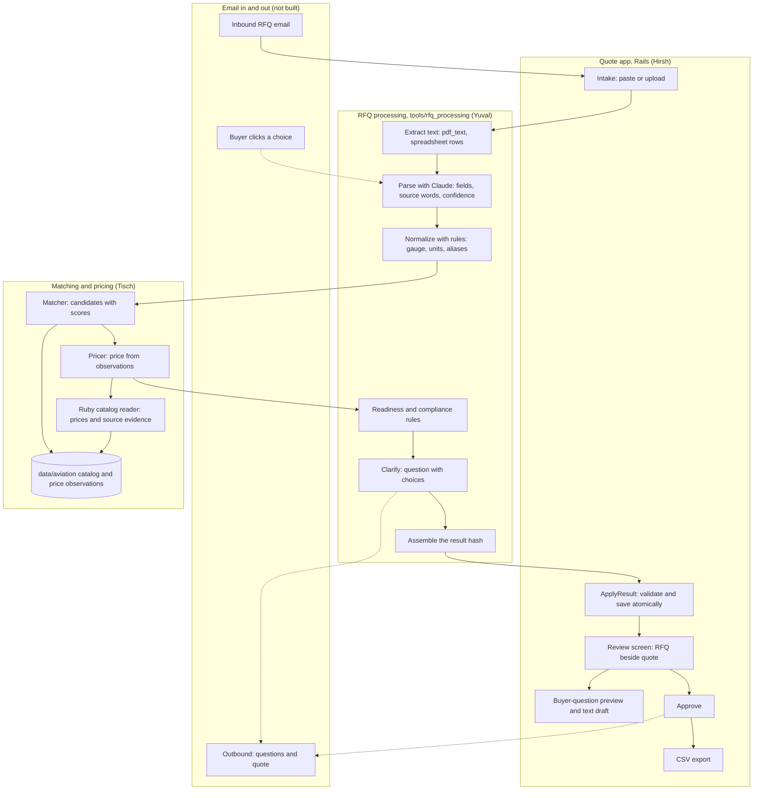

# RFQ to Quote: Architecture

**Status:** Living document, approved by Ken 2026-10-10. Draft 1 written by Ken's agent from the code and docs on `main` at `ec0924b`. **Every owner keeps their section current** (see [Keeping this current](#keeping-this-current)).

**Read with:** [the product brief](product/PRD.md) (what and why), [the demo workflow](product/WORKFLOW.md) (the steps), [the frontend contract](engineering/FRONTEND_CONTRACT.md) (app routes and models), [the result format](rfq_processing/RESULT-FORMAT.md) (the processing hash), [catalog and pricing](data/CATALOG_PRICING.md).

## Summary

The system has four parts:

- **The quote app** (Hirsh): a Rails 8 app at the repo root. The rep sees the RFQ beside the quote, edits, approves, and exports.
- **RFQ processing** (Yuval): a plain Ruby library in `tools/rfq_processing/`. It turns an RFQ into one result hash.
- **Matching and pricing** (Tisch): finds the catalog item for each line and prices it from sourced observations.
- **Email in and out:** receives the RFQ and sends questions and the quote. **Not built yet.**

They meet at one point. RFQ processing assembles a single hash, and the app takes it through `QuoteWorkspace::ApplyResult.call(quote:, result:)`.

## The system

Solid lines exist or are being built. Dotted lines are planned.

## Components

### Quote app (Hirsh)

- **Where:** repo root. `app/controllers/quotes_controller.rb`, `quote_lines_controller.rb`, `buyer_questions_controller.rb`; `app/models/quote.rb`, `quote_line.rb`; `app/services/quote_workspace/` (`apply_result.rb`, `demo.rb`, `csv_export.rb`, `buyer_question_draft.rb`, `session_scope.rb`). Quote and question views live in `app/views/quotes/` and `app/views/buyer_questions/`.
- **Stack:** Ruby 3.4.11, Rails 8.1.4, SQLite. Setup in [BASELINE.md](engineering/BASELINE.md).
- **What works today:** intake by paste or upload, a labeled sample quote, source-backed review, attention/ready filters, held-line navigation, line edits, approval, and CSV export. Buyer questions consolidate into a labeled draft with edit links and plain-text download; every held line needs a question before download. Hardware fields retain evidence, appear on relevant lines, and export under matching column headers.
- **Key rules:**
  - Workspaces are scoped to a browser session. This is not real authentication.
  - Uploads stay "awaiting processing" until a valid result arrives. Nothing is invented.
  - Any edit clears approval. A stale review cannot approve newer content (`Quote#review_revision`).
  - Held lines never count toward the subtotal. Sample data is labeled SAMPLE.
- **Processing integration:** stores optional `revision` as `Quote#processing_revision`, plus each line's `line_id` and `processing` JSON. Existing schema-version-1 payloads still work. Metadata is validated and stored atomically with the result; it never grants readiness or approval.
- **Incoming catalog services:** Tisch's `app/services/catalog_match/` and client/match-request models are on main; their migration is applied locally. No quote UI route invokes them yet. The description/struct-based matcher and direct line writer need reconciliation with Yuval's single-result contract before wiring. Integration findings are on the bulletin at 13:06.
- **Checked:** 125 Rails tests / 918 assertions and 12 PDF utility specs pass. Opus 5.5 reviewed fixed UI and metadata snapshots; findings were fixed. Desktop/mobile review navigation, question-edit return and actual draft download were verified in the browser.
- **Latest teammate sync:** 148 Rails tests / 1,028 assertions, 12 PDF specs and the standalone reader's 9 tests / 222 assertions pass with the 500-item aviation catalog. These checks do not establish that the unwired matcher and processing contracts agree.
- **Remaining gaps:** real parser invocation, result `source`/`warnings` presentation, email transport, buyer-choice response endpoints and re-quote history/redlines. Preview/download are read-only and never report a sent message. Stored choice/revision metadata prepares replies but does not implement them.

### RFQ processing (Yuval)

- **Where:** `tools/rfq_processing/` (library and specs), `docs/rfq_processing/` (plan and format). Plain Ruby, no Rails. The app loads it as a path gem.
- **The pipeline**, from [PLAN.md](rfq_processing/PLAN.md):
  1. Extract: email text passes through, PDFs go through `tools/pdf_text`, spreadsheets become one line per row. Page and row positions are kept.
  2. Parse: one Claude call per RFQ (Opus 5.5, structured output). Each field returns a value, the exact source words, and a confidence.
  3. Normalize with rules: gauge to inches by material, feet to inches, "4x8" to 48 by 96, aliases, AN part numbers.
  4. Match: calls Tisch's matcher.
  5. Readiness with rules. A confidence score never makes a line Ready when evidence is missing.
  6. Compliance flags from a rules table. Each flag carries its source words.
  7. Clarify: rules decide a line is unclear. A second Claude call words the question with two or three catalog-grounded choices.
  8. Assemble the result hash.
- **Status:** the result format and three fixtures (Ready, Needs the buyer, No match) are done. All three pass `ApplyResult`. The parser, normalizer, and rules are in progress.

### Matching and pricing (Tisch)

- **Where:** `data/aviation/` (catalog and observations), `tools/catalog_research/catalog_reader.rb` (Ruby data adapter and validation), `tools/catalog_research/` (offline supplier-research scripts), `docs/data/`. The Rails app can read the JSON through Ruby without a Node runtime dependency.
- **Data today:** [500 aviation hardware items](data/AVIATION_ITEMS_500.md) and 1,000 real public dealer price observations, two per item. Includes bolts, screws, nuts, washers and gaskets. Original AVI-001 through AVI-200 are preserved. Each observation has a URL, retrieval time and one-piece price basis. Both dealers report stock at retrieval. The assembled catalog is labeled sample data and does not claim RudCo stock.
- **Specification status:** 225 items have agreeing readable dimensional fields. Another 275 have real same-part price evidence but need supplier specification confirmation. Readable conflicts were rejected. Explicit right-hand nut SKU mappings are recorded. None is certified for a particular helicopter or automatically ready to quote.
- **Matcher contract** (from [RESULT-FORMAT.md](rfq_processing/RESULT-FORMAT.md)): callable from Ruby in-process, or as a JSON stdin/stdout command. Input is the normalized spec plus the line text. Output is candidates with scores and reasons. RFQ processing stays the single assembler of the hash the app receives.
- **Pricing:** a two-dealer midpoint is the reference today. It is product only and single piece. Entries with supplier specification gaps carry a provisional qualification. The Ruby reader uses BigDecimal and exposes source evidence and gaps. Suggested selling prices stay null until actual order terms, costs and required charges are confirmed.
- **Status:** the catalog and Ruby data reader are built and validated. Nine Ruby tests (222 assertions), seven research-parser tests and full verification of all 1,000 prices against saved supplier pages pass. The scored matcher and final selling-price policy remain to be implemented. Loading evidence is not the agreed matcher implementation.
- **Reader interface:** `RfqCatalog::Reader.new(Rails.root.join("data/aviation"))`, `validate!`, `find(part_number)`, `offers_for(part_number)`, and `price_reference(part_number)`. Details and Rails example: [data README](../data/aviation/README.md).

### Email in and out (not built)

- **Inbound:** receive the RFQ email and its attachments, then create a quote. Today the rep pastes or uploads instead.
- **Outbound questions:** send automatically when the agent is confident about the choices, otherwise after rep review ([WORKFLOW.md](product/WORKFLOW.md), W1).
- **Buyer response:** each choice is a button in the email. A click updates the RFQ with no login (W2). Reply-by-number is the fallback.
- **Final quote:** sent on the buyer's original thread after the rep approves.
- **How (Ken, 2026-10-10):** start with letter_opener, which opens each sent email in the browser in development. Then connect a real email account for inbound RFQs and outbound replies.
- **Owner:** Hirsh owns the question and response UI, and is the proposed owner of the mail connection.

## Contracts

| Contract | Between | Defined in | Status |
|---|---|---|---|
| Result hash (`schema_version: 1`) | RFQ processing → app | [RESULT-FORMAT.md](rfq_processing/RESULT-FORMAT.md), [FRONTEND_CONTRACT.md](engineering/FRONTEND_CONTRACT.md) | Draft 1, three fixtures pass |
| `ApplyResult.call(quote:, result:)` | RFQ processing → app | `app/services/quote_workspace/apply_result.rb` | Built |
| Matcher input and output | RFQ processing ↔ Tisch | [RESULT-FORMAT.md](rfq_processing/RESULT-FORMAT.md) | Agreed in principle |
| Stable `line_id` and `revision.id` | Processing → app → email | [RESULT-FORMAT.md](rfq_processing/RESULT-FORMAT.md) | Stored by the app. Reply validation and history still pending |
| Question choice IDs | Processing → email → app | [RESULT-FORMAT.md](rfq_processing/RESULT-FORMAT.md) | Stored in `processing.question_choices`; response handler must bind choices to the originating revision |
| Catalog evidence reader | Tisch → RFQ processing / Rails | [Data README](../data/aviation/README.md), `tools/catalog_research/catalog_reader.rb` | Built; Ruby tests pass; price evidence only, no result assembly |

## Data model

- **`Quote`:** title, buyer name, source text and file, session token, sample flag, approval time, review revision, optional processing revision (JSON). Has many ordered `QuoteLine`s.
- **`QuoteLine`:** original text, metals/hardware spec (JSON), quantity and unit, catalog SKU, unit price, price source, state (`ready`, `needs_buyer`, `no_match`), clarification question, notes, evidence (JSON, per field), compliance (JSON), benchmark (JSON), unresolved and edited fields, optional `line_id` and `processing` JSON.
- Full field list in the [frontend contract](engineering/FRONTEND_CONTRACT.md).

## Trust rules the architecture enforces

These come from the [product brief](product/PRD.md) commitments.

- **Show the source.** Every spec field has an evidence entry: the exact RFQ words, their location, and the rule used.
- **Ask, don't guess.** Unknowns stay null. Readiness is a fixed rule, not a score.
- **No hallucinated pricing.** A Ready line needs a price with a named source. The LLM never sets a price.
- **Label sample data.** `sample_data` is true whenever the catalog or prices are ours.
- **A person approves the final quote.** Approval is explicit, and any edit clears it.

## Open questions and known gaps

- **Lead time per line and in the export (Ken, 13:00).** Newly required, not implemented yet. Unknown timing must display "to confirm"; RudCo's 24 to 48 hour shipping promise applies only to confirmed stocked items, not an arbitrary match in the sample catalog. Owner: Hirsh, with stock/lead-time evidence from Yuval and Tisch.
- **Demo materials catalog (W4).** Tisch's current user-requested catalog is 500 aviation hardware items. Ken's 13:00 workflow requests steel shot S-330, P1020 aluminum ingot, aluminum 356, steel plate and the stainless gauge line. These need a separately sourced materials catalog; they are not fabricated or added to the aviation list in this change. Owner: Tisch.
- **Processing data still awaiting presentation.** Hardware spec keys, `processing`, `line_id`, and `revision` now persist. Top-level extraction `source`/`warnings` are not yet stored or shown. Owner: Hirsh, coordinated with Yuval.
- **Who sets `unit_price` on a Ready line.** Yuval proposes copying Tisch's suggested price, with the rep able to edit. Owners: Hirsh, Tisch.
- **W3: does a buyer's answer rerun only the answered lines?** Owner: Ken.
- **Mail adapter.** letter_opener first, then a real email account. Proposed owner: Hirsh.
- **Anthropic API key.** Specs run on recorded responses until one is in `.env`. Owner: Yuval.
- **Re-quote on change** (bulletin, 12:42). Detection would sit in RFQ processing after the core pipeline works. No owner yet.

## Keeping this current

This document is shared. When you change a component, a contract, or a status:

1. Update your component's section and the Contracts table in the same commit.
2. Move a closed item out of Open questions, and note what was decided.
3. Update the diagram if a box or arrow changes.
4. Post on the bulletin board when a contract changes, with @-mentions for the other side.

Keep each section short. Detail lives in your own docs; link to them from here.
