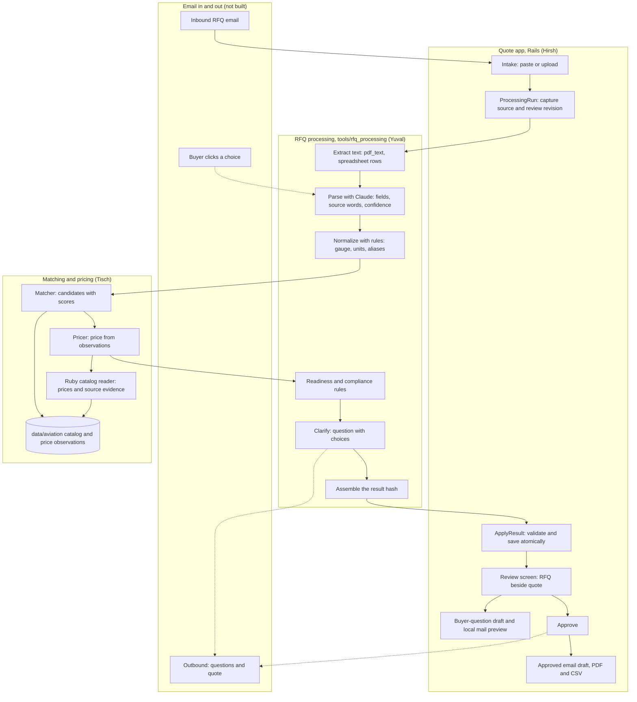

# RFQ to Quote: Architecture

**Status:** Living document, approved by Ken 2026-10-10. Draft 1 written by Ken's agent from the code and docs on `main` at `ec0924b`. **Every owner keeps their section current** (see [Keeping this current](#keeping-this-current)).

**Read with:** [the product brief](product/PRD.md) (what and why), [the demo workflow](product/WORKFLOW.md) (the steps), [the frontend contract](engineering/FRONTEND_CONTRACT.md) (app routes and models), [the result format](rfq_processing/RESULT-FORMAT.md) (the processing hash), [catalog and pricing](data/CATALOG_PRICING.md).

## Summary

The system has four parts:

- **The quote app** (Hirsh): a Rails 8 app at the repo root. The rep sees the RFQ beside the quote, edits, approves, and exports.
- **RFQ processing** (Yuval): a plain Ruby library in `tools/rfq_processing/`. It turns an RFQ into one result hash.
- **Matching and pricing** (Tisch): finds the catalog item for each line and prices it from sourced observations.
- **Email in and out (Hirsh):** local question and approved-quote previews with PDF/CSV attachments. A real mailbox and buyer responses are still pending.

They meet at one point. RFQ processing assembles a single hash, and the app takes it through `QuoteWorkspace::ApplyResult.call(quote:, result:)`.

## The system

Solid lines exist or are being built. Dotted lines are planned.

## Components

### Quote app (Hirsh)

- **Where:** Rails root, `app/controllers/`, `app/models/`, `app/jobs/process_rfq_job.rb`, `app/services/quote_workspace/`, `app/mailers/quote_mailer.rb`, and quote, question, final-quote and catalog views. Stack and setup: [BASELINE.md](engineering/BASELINE.md).
- **Review:** session-scoped intake, source beside quote, filters, line edits, held-line questions, explicit approval and four-decimal unit prices. The internal `needs_buyer` state displays as `Question to send`, with counts expressed as questions to send. A successful current per-question local preview displays `Waiting on buyer` with an explicit local-demo label; it is not external delivery. Failed or stale previews stay `Question to send`. Line selection opens its detail directly under the row, updates source highlights together, and keeps native navigation as a fallback. Unsaved edits require confirmation before switching lines. Every edit invalidates approval. Unselected alternatives are separate from the subtotal; other held lines remain unpriced.
- **Processing:** intake queues `ProcessRfqJob`. `ProcessingRun` snapshots the source and review revision. Provider work happens outside the quote lock; applying results rechecks the revision, run and rep edits. Duplicate requests share an active run. Explicit retries replace timed-out runs after five minutes. Errors preserve existing lines. The public full-retry action accepts only quotes without lines. A rep-entered buyer answer selectively reruns one held line with fresh review and processing revision guards, preserving other rows and rep edits.
- **Matcher boundary:** initial intake uses Yuval's adapter with RudCo/metals catalogs. The app accepts the adapter's normalized spec/quantity arguments and forwards its given-spec mapping when available while keeping inferred client memory disabled. App intake and buyer-answer reruns explicitly disable both the processing LLM and the catalog matcher's separate optional LLM, even when provider credentials exist. Aviation stays excluded until its specification holds survive the shared adapter. Per-pound prices require a positive price and an `lb` quantity. Explicit known catalog part numbers require rep review until the matcher validates all stated attributes. Matcher failures become processing errors. Buyer context is workspace-scoped and passes explicitly taught terms only; inferred catalog memory remains excluded pending confirmation provenance.
- **Evidence:** `ApplyResult` validates and saves optional `revision`, per-line `line_id`/`processing`, extraction `source` and `warnings` in the same transaction as lines. Source type, extraction warnings and run metadata live in a collapsed header disclosure; they do not grant readiness. Sourced lead times appear in the review, CSV, email and PDF. The app bridges valid `processing.lead_time` metadata for Ready lines into display fields; unknown or explicit third-party stock cannot establish RudCo timing. Missing timing is "to confirm".
- **Local demo workspace:** in development, an empty session workspace receives twelve persisted RFQs on its first Quotes-list visit. The local rules pipeline supplies the added material requests; existing records are preserved. Explicit `DemoWorkspace.populate!` tops older local workspaces up to twelve. Fixtures include varied received times, approved unsent quotes and two constructed sent-history records. No email is sent by seeding. Production never seeds automatically. The explicit development task `bin/rails demo:refresh_timing` refreshes only recognized, untouched generated fixtures and their constructed sent history; normal page visits never retime existing RFQs.
- **Final quote:** approved snapshot produces a buyer-facing email body, PDF and CSV. Internal notes stay out. A stale or revoked approval blocks export. Embedded PDF fonts preserve industrial symbols and fail explicitly if a character cannot be rendered. Internal data provenance is retained; Ken's 13:48 video-demo presentation removes concept/sample banners and labels.
- **Local mail:** `EmailPreview` captures one locked revision and frozen attachment bytes. Development uses a silent local letter_opener renderer; tests use the test mailer. Messages and attachments are available from the workspace-scoped local inbox. No delivery opens browser tabs. Production transport is disabled. A preview never marks a final quote sent. `DispatchBuyerQuestionJob` runs only after explicit question-drafting work commits: intake processing, buyer answers or an edited question. Generic model saves, page loads and demo seed/reseed operations never enqueue it. `BuyerQuestionDelivery` records the exact question, line snapshot, placeholder recipient, mode and preview time. Fingerprints deduplicate attempts and invalidate waiting labels after question/spec changes. The activity history survives line replacement, and unchanged drafts retain their receipt to prevent another preview. This local-only path does not enable production sending or satisfy the pending external confidence gate.
- **Buyer teaching:** an explicit quote-scoped submission stores supported ClientTerm fields, same-buyer/workspace identity and trusted source RFQ/line provenance. BuyerContext passes validated `confirmed_on` to processing; unconfirmed automatic memory stays excluded. Typed gauge/thickness and quantity-unit teaching follow ClientTerm, with finite numeric validation at the quote endpoint.
- **Options:** review and approved email/PDF/CSV consume `processing.alternates`. Option prices require positive decimals, USD, a named dated benchmark with matching units, and no unresolved fields. Matching units accept a bare sale unit or an explicit USD basis. Valid dated observations may carry a strict timezone-bearing ISO timestamp, preserved as source evidence. Options are never summed together or included in the Ready subtotal.
- **Desk deadlines:** receipt plus 24 hours determines the due countdown and soonest-due order. Less than eight hours remaining is amber; overdue is red. `sent_at` and `sent_review_revision` distinguish delivery of the current approved revision from a preview or a later edit. Live delivery is still pending.
- **Design:** Ken's [style guide](product/STYLE_GUIDE.md) governs all page tokens and the unchanged RudCo logo. [UI components](engineering/UI_COMPONENTS.md) documents the shared Rails/CSS pieces, including catalog pages.
- **Marketing:** read-only `/product` and `/compare` routes use `MarketingController`, a separate marketing layout and scoped styles. The product page embeds an actual local demo screenshot. The comparison links directly to reviewed vendor pages and distinguishes shipped quote preparation from unconnected delivery, ERP and inventory. These pages do not create quotes or buyer records.
- **Remaining:** production authentication/storage, real mailbox/thread IDs, public buyer-choice endpoints and evidence gate, general re-quote conflict/redline review, and live gateway activation. The current session workspace is a local prototype.

### RFQ processing (Yuval)

- **Where:** `tools/rfq_processing/` (library and specs), `docs/rfq_processing/` (plan and format). Plain Ruby, no Rails. The app loads it as a path gem.
- **The pipeline**, from [PLAN.md](rfq_processing/PLAN.md):
  1. Extract: email text passes through, PDFs go through `tools/pdf_text`, spreadsheets become one line per row. Page and row positions are kept.
  2. Parse: the rules parser reads every line; one Claude call per line (Claude Opus 5, through the Nicrron gateway or the Anthropic API, structured output) fills only what the rules left empty. Each field returns a value, the exact source words, and a confidence.
  3. Normalize with rules: gauge to inches by material, feet to inches, "4x8" to 48 by 96, aliases, AN part numbers.
  4. Match: calls Tisch's matcher through `CatalogMatchAdapter`; falls back to the library's `CatalogMatcher` for JSON catalogs.
  5. Readiness with rules. A confidence score never makes a line Ready when evidence is missing.
  6. Compliance flags from a rules table. Each flag carries its source words.
  7. Clarify: rules form one buyer question with choices from gauge tables or catalog candidates. No second live model call is required.
  8. Assemble the result hash.
- **Parser handoff, teammate inspected:** buyer terms retain their confirmed RFQ in evidence, packaging does not replace demand, and glass bead sizes, stainless shot and Gage dimensions have regression coverage.
- **Provider, inspected while disabled:** Nicrron and direct Anthropic adapters preserve model identity and evidence guards. Diagnostics log class/status only; 73 isolated provider specs pass. Both app paths remain explicitly `llm: false`, so this does not activate a provider.
- **Integrated processing batch, teammate inspected:** provider metadata, stable alternate IDs, candidate-selection guards, selective answer reruns and buyer-term source RFQ evidence. The library is tested offline; no live provider run is claimed. Missing or different model identity is rejected, rules values are retained, and model fills require whole-token evidence and high confidence.
- **Extraction:** PDF page counts and page/line evidence are retained. Quantity-table boundaries assemble wrapped descriptions and exclude tender boilerplate. Explicit `Line` columns are separated from dimensions in PDF/CSV/Excel. Package weights never replace order demand. Unrecognized tables and cross-page continuations carry review warnings; this is bounded rules extraction, not general PDF understanding.
- **Answer and evidence contract:** `Answers.apply` keeps its public signature and stable line IDs. Original scoped body requirements remain in optional `processing.rfq_body`, so reruns recompute MTR/COA scope without losing the RFQ context. Buyer terms name `confirmed_on` in field evidence; taught readings still flag contradictory explicit dimensions.
- **Prices and choices:** `processing.alternates` includes eligible, specification-compatible candidates only. No-match closest items cannot be promoted by an answer. Prices require a compatible sale unit and positive USD amount. Dates come from the source or verified catalog manifest. Missing prices remain held; no metals prices are synthesized.
- **App boundary:** Hirsh's `QuoteWorkspace::ProcessRfq::IntakeMatcher` remains on RudCo/metals with `llm: false`. No app screens, catalog data or matcher/pricer implementation changed in this lane. The current gate results and unresolved external dependencies are in [HANDOFF.md](rfq_processing/HANDOFF.md).

### Matching and pricing (Tisch)

- **Live pricing agent and website:** `tools/distributor_pricing/` and `DistributorPricing::QuoteAgent.call` accept an RFQ and required delivery destination. `/quotes/:id/pricing` queues `PriceRfqJob` and persists `PricingRun` evidence outside the network lock. Each run refreshes supplier pages and FRED, compares five independent delivered competitors per item, and prices evidenced landed cost at 15% target / 8% minimum gross margin. Exact, unedited USD lines can receive ready prices through the existing handoff. Source/revision/expiry guards preserve edits and prevent stale approval/export. Every item carries sourced lead time or an explicit confirmation gap. Public listings remain provisional; no executable procurement feed is connected. Contract and limits: [pricing agent](data/DISTRIBUTOR_PRICING_AGENT.md).
- **Public RFQ example:** [Transnet steel shot](example_rfqs/transnet-steel-shot-2024/SOURCE.md) includes the authentic 35-page PDF and extracted text. The closed December 2024 request asks for 50,000 kg of S390; blank price fields provide no benchmark. Source, packaging, currency and specification conflicts are recorded for intake tests.
- **Where:** `data/aviation/` (catalog and observations), `tools/catalog_research/catalog_reader.rb` (Ruby data adapter and validation), `tools/catalog_research/` (offline supplier-research scripts), `docs/data/`. The Rails app can read the JSON through Ruby without a Node runtime dependency.
- **Data today:** [500 aviation hardware items](data/AVIATION_ITEMS_500.md) and 1,000 real public dealer price observations, two per item. Includes bolts, screws, nuts, washers and gaskets. Original AVI-001 through AVI-200 are preserved. Each observation has a URL, retrieval time and one-piece price basis. Both dealers report stock at retrieval. The assembled catalog is labeled sample data and does not claim RudCo stock.
- **Specification status:** 225 items have agreeing readable dimensional fields. Another 275 have real same-part price evidence but need supplier specification confirmation. Readable conflicts were rejected. Explicit right-hand nut SKU mappings are recorded. None is certified for a particular helicopter or automatically ready to quote.
- **Demo catalogs:** [data/rudco/](../data/rudco/) has 96 items parsed from RudCo's own public site (steel shot S-170 to S-780, steel grit, aluminum oxide, garnet, glass bead, P1020, 356, A356 and other aluminum ingot and sow), with RudCo's website list $/lb labeled as website list prices, not quote prices. [data/metals/](../data/metals/) has 143 constructed sample sheet, plate, tube, angle, bar and pipe items covering the research test set; no prices. Builders: `tools/catalog_research/build_rudco_catalog.rb`, `build_metals_catalog.rb`.
- **Matcher:** `app/services/catalog_match/`. `DescriptionReader` reads a line with fixed rules (gauge tables keyed by material and form, feet vs inches, SAE shot and grit sizes, alloys, AN/MS part numbers); every field keeps the words it came from. `Matcher` checks each catalog item field by field: exact, near (becomes a buyer question) or conflict (rules the item out). Outcomes: match, candidates with one question, or no match with the closest items listed but never forced.
- **Matcher contract** (from [RESULT-FORMAT.md](rfq_processing/RESULT-FORMAT.md)): `CatalogMatch::Contract.call("line_text" => ..., "spec" => {...})` in-process, or `bin/catalog-match` (one JSON object on stdin, one on stdout). Returns `status` (exact, scored, ambiguous, no_match), `threshold` 0.8, `best`, up to 3 `candidates` with 0 to 1 scores, `matched_on`, `mismatches`, plus `question` and `closest`. A normalized spec from processing fills only what the line text left out. RFQ processing stays the single assembler of the hash the app receives.
- **Per-client memory:** `Client`, `ClientTerm`, `MatchRequest` (migration `20261010181500`), scoped to the workspace token. When the rep approves an item, the client's unknown words and the exact request are remembered for that client only; the rep can teach or forget a word. Taught terms are never overwritten by learning. The buyer's explicit words always beat memory.
- **Approve to RFQ:** `CatalogMatch::Approve` adds approved items to an RFQ as held `QuoteLine`s (catalog_sku, spec, evidence, quantity, `unresolved_fields: ["unit_price"]`, `line_id`, processing provenance with `sample_data`). Once per request, same workspace only. The rep page is `/catalog_matches`; page ownership is being settled with Hirsh.
- **Pricing:** a two-dealer midpoint is the reference today. It is product only and single piece. Entries with supplier specification gaps carry a provisional qualification. The Ruby reader uses BigDecimal and exposes source evidence and gaps. Suggested selling prices stay null until actual order terms, costs and required charges are confirmed.
- **Status:** catalog, reader, matcher and live distributor pricing service are built. Pricing has 98 tests / 594 assertions passing, including five-competitor gating, freshness, exact SKU/unit checks, margin floors and sourcing holds. Website integration is in progress. The existing catalog reader's nine tests / 222 assertions and saved-page checks remain separate evidence.
- **Reader interface:** `RfqCatalog::Reader.new(Rails.root.join("data/aviation"))`, `validate!`, `find(part_number)`, `offers_for(part_number)`, and `price_reference(part_number)`. Details and Rails example: [data README](../data/aviation/README.md).

### Email in and out (Hirsh)

- **Inbound:** receive the RFQ email and its attachments, then create a quote. Today the rep pastes or uploads instead.
- **Outbound questions:** send automatically when the agent is confident about the choices, otherwise after rep review ([WORKFLOW.md](product/WORKFLOW.md), W1).
- **Buyer response:** each choice is a button in the email. A click updates the RFQ with no login (W2). Reply-by-number is the fallback.
- **Final quote:** sent on the buyer's original thread after the rep approves.
- **Local preview built:** the silent letter_opener renderer saves question drafts and approved final quotes with PDF/CSV attachments in development. The scoped local inbox opens only when the rep selects it. It uses fixed `.invalid` recipients and cannot fall through to SMTP. Real inbound/outbound mail remains pending credentials and thread metadata.
- **Owner:** Hirsh owns the mail integration and question/response UI. Ken has been asked to name the credential owner and secure handoff method.

## Contracts

| Contract | Between | Defined in | Status |
|---|---|---|---|
| Result hash (`schema_version: 1`) | RFQ processing → app | [RESULT-FORMAT.md](rfq_processing/RESULT-FORMAT.md), [FRONTEND_CONTRACT.md](engineering/FRONTEND_CONTRACT.md) | Draft 1, three fixtures pass |
| `ApplyResult.call(quote:, result:)` | RFQ processing → app | `app/services/quote_workspace/apply_result.rb` | Built |
| Matcher input and output | RFQ processing ↔ Tisch | [RESULT-FORMAT.md](rfq_processing/RESULT-FORMAT.md) | Shared adapter wired for RudCo/metals intake; aviation readiness integration pending |
| Stable `line_id` and `revision.id` | Processing → app → email | [RESULT-FORMAT.md](rfq_processing/RESULT-FORMAT.md) | Stored by the app. Reply validation and history still pending |
| Question choice IDs | Processing → email → app | [RESULT-FORMAT.md](rfq_processing/RESULT-FORMAT.md) | Stored in `processing.question_choices`; response handler must bind choices to the originating revision |
| Catalog evidence reader | Tisch → RFQ processing / Rails | [Data README](../data/aviation/README.md), `tools/catalog_research/catalog_reader.rb` | Built; Ruby tests pass; price evidence only, no result assembly |

## Data model

- **`Quote`:** title, buyer name, source text and file, session token, sample flag, approval time, review revision, optional processing revision/source/warnings (JSON). Has many ordered `QuoteLine`s and `ProcessingRun`s.
- **`ProcessingRun`:** queued/running/succeeded/failed/stale/conflict, source snapshot, requested and captured review revisions, timestamps and bounded failure details.
- **`QuoteLine`:** original text, metals/hardware spec (JSON), quantity and unit, catalog SKU, unit price, price source, state (`ready`, `needs_buyer`, `no_match`), clarification question, notes, evidence (JSON, per field), compliance (JSON), benchmark (JSON), unresolved and edited fields, optional `line_id` and `processing` JSON, lead time and its source.
- Full field list in the [frontend contract](engineering/FRONTEND_CONTRACT.md).

## Trust rules the architecture enforces

These come from the [product brief](product/PRD.md) commitments.

- **Show the source.** Every spec field has an evidence entry: the exact RFQ words, their location, and the rule used.
- **Ask, don't guess.** Unknowns stay null. Readiness is a fixed rule, not a score.
- **No hallucinated pricing.** A Ready line needs a price with a named source. The LLM never sets a price.
- **Keep provenance.** Stored `sample_data` and benchmark kind distinguish constructed fixtures from observations. Ken's 13:48 presentation omits concept/sample labels for the RudCo demo video.
- **A person approves the final quote.** Approval is explicit, and any edit clears it.

## Open questions and known gaps

- **Stock evidence:** lead-time storage and display are built. Unknown timing displays "to confirm". Confirmed stocked rows still need catalog evidence before applying RudCo's 24 to 48 hour promise. Owners: Yuval and Tisch for evidence, Hirsh for presentation.
- **Demo materials catalog (W4).** Tisch's current user-requested catalog is 500 aviation hardware items. Ken's 13:00 workflow requests steel shot S-330, P1020 aluminum ingot, aluminum 356, steel plate and the stainless gauge line. These need a separately sourced materials catalog; they are not fabricated or added to the aviation list in this change. Owner: Tisch. **Update (Tisch, 13:30):** answered: metals first, bolts second. RudCo's own materials are in `data/rudco/` from RudCo's public site; plate and the stainless gauge line are in `data/metals/` (constructed sample). Still open: real stock, lead times and quote prices for these rows.
- **Who sets `unit_price` on a Ready line.** Yuval proposes copying Tisch's suggested price, with the rep able to edit. Owners: Hirsh, Tisch.
- **Real mail account.** Local letter_opener preview is built. Credentials and original thread metadata remain outstanding. Owner: Hirsh; credential supplier requested from Ken.
- **Anthropic API key.** Specs run on recorded responses until one is in `.env`. Owner: Yuval.
- **Learn the buyer (workflow step 9, Ken, 13:23).** Now in scope. When the rep confirms or corrects a reading, it is saved for that buyer and applied to their next RFQ, with the source shown on the line. Needs a place to store confirmed readings per buyer, and a hook in parsing to apply them. Hirsh owns app storage/integration; Yuval owns parser application, coordinated with Tisch's ClientTerm store. Only explicitly taught terms are accepted by intake today.
- **Alternates on unclear lines (Ken, 2026-10-10).** When the matcher returns two or three candidates for a line, or a line has two readings such as "16 ga" and "0.060 in", the quote shows each as an option with its own price and does not hold the line. The buyer picks one when they accept, and the clarifying question still goes out. A line with no match, or with no benchmark price, stays held. This supports the 24-hour quote requirement: an unclear line never holds the quote back. Yuval: processing already returns the candidates; carry every reading and candidate per line in the result hash. Tisch: price each candidate (needs the pricer). Hirsh: show alternates on the review screen and in the quote PDF, and record which option the buyer picks.
- **Re-quote on change** (bulletin, 12:42). Detection would sit in RFQ processing after the core pipeline works. No owner yet.

## Keeping this current

This document is shared. When you change a component, a contract, or a status:

1. Update your component's section and the Contracts table in the same commit.
2. Move a closed item out of Open questions, and note what was decided.
3. Update the diagram if a box or arrow changes.
4. Post on the bulletin board when a contract changes, with @-mentions for the other side.

Keep each section short. Detail lives in your own docs; link to them from here.

### Live model activation checkpoint, 15:11

`QuoteWorkspace::LiveModels` permits optional RFQ parser enrichment only in development with `RFQ_LIVE_MODELS=1`. The default is off. Intake and buyer-answer processing share the switch; catalog-model calls remain off because their field provenance is not yet projected into processing results. Accepted parser fills retain source explanations. Rules values and prices are never replaced by the model. Missing keys or provider failures retain rules.

The unsafe matcher shortcut that treated a numeric difference within five percent as buyer confirmation is removed. Plain normalized `given` values can fill missing fields but cannot override explicit source numbers. A new vetted confirmation interface still needs agreement with Yuval and Ken. Catalog model responses must identify the requested model exactly, allowing only explicit dated variants, never a missing identity or an Opus 5.5 prefix match.

Hirsh’s live check found the configured Opus 5 in the gateway model list, but inference returned HTTP 502 twice. The app switch remains off. Configuration and a model-list response are not evidence of a successful model reading.
