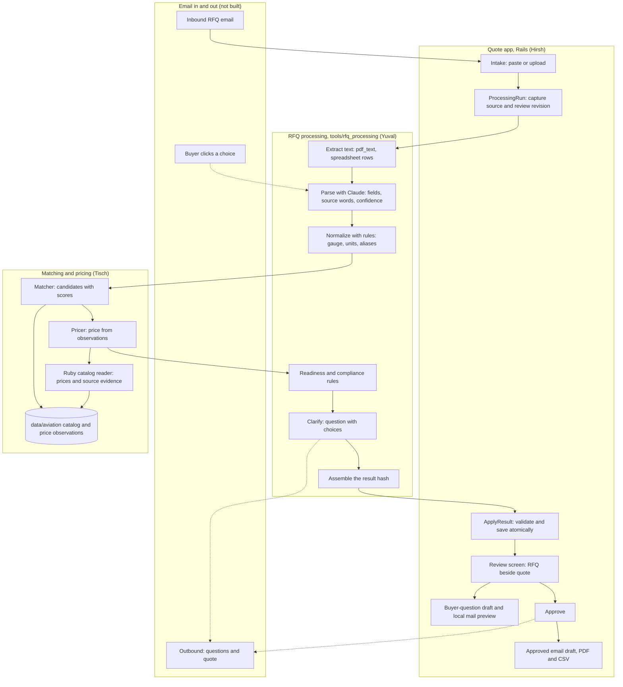

# RFQ to Quote: Architecture

**Status:** Living document, approved by Ken 2026-10-10. Draft 1 written by Ken's agent from the code and docs on `main` at `ec0924b`. **Every owner keeps their section current** (see [Keeping this current](#keeping-this-current)).

**Read with:** [the product brief](product/PRD.md) (what and why), [the demo workflow](product/WORKFLOW.md) (the steps), [the frontend contract](engineering/FRONTEND_CONTRACT.md) (app routes and models), [the result format](rfq_processing/RESULT-FORMAT.md) (the processing hash), [catalog and pricing](data/CATALOG_PRICING.md).

## Summary

The system has four parts:

- **The quote app** (Hirsh): a Rails 8 app at the repo root. The rep sees the RFQ beside the quote, edits, approves, and exports.
- **RFQ processing** (Yuval): a plain Ruby library in `tools/rfq_processing/`. It turns an RFQ into one result hash.
- **Matching and pricing** (Tisch): finds the catalog item for each line and prices it from sourced observations.
- **Email in and out (Hirsh):** local question and approved-quote previews with PDF/CSV attachments. A real mailbox and buyer responses are still pending.

They meet at one point. RFQ processing assembles a single hash, and the app takes it through `QuoteWorkspace::ApplyResult.call(quote:, result:)`.

## The system

Solid lines exist or are being built. Dotted lines are planned.

## Components

### Quote app (Hirsh)

- **Where:** Rails root, `app/controllers/`, `app/models/`, `app/jobs/process_rfq_job.rb`, `app/services/quote_workspace/`, `app/mailers/quote_mailer.rb`, and quote, question, final-quote and catalog views. Stack and setup: [BASELINE.md](engineering/BASELINE.md).
- **Review:** session-scoped intake, source beside quote, filters, line edits, held-line questions, explicit approval and four-decimal unit prices. Every edit invalidates approval. Held lines are unpriced and excluded from totals.
- **Processing:** intake queues `ProcessRfqJob`. `ProcessingRun` snapshots the source and review revision. Provider work happens outside the quote lock; applying results rechecks the revision, run and rep edits. Duplicate requests share an active run. Explicit retries replace timed-out runs after five minutes. Errors preserve existing lines. The public retry action accepts only quotes without lines; partial reruns are still pending.
- **Matcher boundary:** initial intake uses Yuval's adapter with RudCo/metals catalogs. Aviation stays excluded until its specification holds survive the shared adapter. Per-pound prices require a positive price and an `lb` quantity. Explicit known catalog part numbers require rep review until the matcher validates all stated attributes. Matcher failures become processing errors. Buyer context is workspace-scoped and passes explicitly taught terms only; inferred catalog memory remains excluded pending confirmation provenance.
- **Evidence:** `ApplyResult` validates and saves optional `revision`, per-line `line_id`/`processing`, extraction `source` and `warnings` in the same transaction as lines. Extraction warnings appear above the review; they do not grant readiness. Sourced lead times appear in the review, CSV, email and PDF. The app bridges valid `processing.lead_time` metadata for Ready lines into display fields; unknown or explicit third-party stock cannot establish RudCo timing. Missing timing is "to confirm".
- **Final quote:** approved snapshot produces a buyer-facing email body, PDF and CSV. Internal notes stay out. A stale or revoked approval blocks export. Embedded PDF fonts preserve industrial symbols and fail explicitly if a character cannot be rendered. Existing synthetic demo data stays labeled until replaced by sourced data.
- **Local mail:** `EmailPreview` captures one locked revision and frozen attachment bytes. Development uses letter_opener; tests use the test mailer. Production transport is disabled. A preview never marks a quote sent.
- **Design:** Ken's [style guide](product/STYLE_GUIDE.md) governs all page tokens and the unchanged RudCo logo. [UI components](engineering/UI_COMPONENTS.md) documents the shared Rails/CSS pieces, including catalog pages.
- **Remaining:** production authentication/storage, real mailbox/thread IDs, buyer-choice endpoints and evidence gate, partial reruns with conflict/redline review, and saving confirmed buyer corrections with their original RFQ provenance. The current session workspace is a local prototype.

### RFQ processing (Yuval)

- **Where:** `tools/rfq_processing/` (library and specs), `docs/rfq_processing/` (plan and format). Plain Ruby, no Rails. The app loads it as a path gem.
- **The pipeline**, from [PLAN.md](rfq_processing/PLAN.md):
  1. Extract: email text passes through, PDFs go through `tools/pdf_text`, spreadsheets become one line per row. Page and row positions are kept.
  2. Parse: the rules parser reads every line; one Claude call per line (Claude Opus 5, through the Nicrron gateway or the Anthropic API, structured output) fills only what the rules left empty. Each field returns a value, the exact source words, and a confidence.
  3. Normalize with rules: gauge to inches by material, feet to inches, "4x8" to 48 by 96, aliases, AN part numbers.
  4. Match: calls Tisch's matcher through `CatalogMatchAdapter`; falls back to the library's `CatalogMatcher` for JSON catalogs.
  5. Readiness with rules. A confidence score never makes a line Ready when evidence is missing.
  6. Compliance flags from a rules table. Each flag carries its source words.
  7. Clarify: rules decide a line is unclear. A second Claude call words the question with two or three catalog-grounded choices.
  8. Assemble the result hash.
- **Status (13:53):** the Claude step is moving to Claude Opus 5 (Hirsh, 13:40) with an OpenAI-compatible client for the Nicrron gateway (`NICRRON_API_KEY`, `NICRRON_BASE_URL`, `NICRRON_MODEL`), the direct Anthropic path kept; the result's `revision.llm` says which provider and model ran, or null for rules only. Hirsh's intake (`QuoteWorkspace::ProcessRfq`) calls `RfqProcessing.process` with a subclass of `CatalogMatchAdapter` (RudCo and metals, `llm: false` until the gateway works). Before that: built and on `main`, 150 specs green, 24 of 25 research lines read as expected ([TEST-RESULTS.md](rfq_processing/TEST-RESULTS.md)). `RfqProcessing.process(content:, type:, filename:, matcher:, buyer_terms:)` returns the schema-1 hash; email, PDF, CSV, and Excel intake. Matching goes through `CatalogMatchAdapter`, which calls Tisch's `CatalogMatch::Contract` directly. The Claude step (`LlmParser`) switches on by itself when `NICRRON_API_KEY` or `ANTHROPIC_API_KEY` is set; no key is in this checkout yet, so the demo runs on the rules parser, which the test set covers. W3 is in: `Answers.apply` reruns only the answered lines, whole-RFQ answers rerun all, every run has a `revision.id`, every line a stable `line_id`, every price its benchmark date. Buyer profiles (step 9, parsing side) take `buyer_terms` in the `ClientTerm` shape. Lead time is in `processing.lead_time` (24 to 48 hours for rows marked stocked, else to confirm). Handoff for the next session: [HANDOFF.md](rfq_processing/HANDOFF.md).

### Matching and pricing (Tisch)

- **Where:** `data/aviation/` (catalog and observations), `tools/catalog_research/catalog_reader.rb` (Ruby data adapter and validation), `tools/catalog_research/` (offline supplier-research scripts), `docs/data/`. The Rails app can read the JSON through Ruby without a Node runtime dependency.
- **Data today:** [500 aviation hardware items](data/AVIATION_ITEMS_500.md) and 1,000 real public dealer price observations, two per item. Includes bolts, screws, nuts, washers and gaskets. Original AVI-001 through AVI-200 are preserved. Each observation has a URL, retrieval time and one-piece price basis. Both dealers report stock at retrieval. The assembled catalog is labeled sample data and does not claim RudCo stock.
- **Specification status:** 225 items have agreeing readable dimensional fields. Another 275 have real same-part price evidence but need supplier specification confirmation. Readable conflicts were rejected. Explicit right-hand nut SKU mappings are recorded. None is certified for a particular helicopter or automatically ready to quote.
- **Demo catalogs:** [data/rudco/](../data/rudco/) has 96 items parsed from RudCo's own public site (steel shot S-170 to S-780, steel grit, aluminum oxide, garnet, glass bead, P1020, 356, A356 and other aluminum ingot and sow), with RudCo's website list $/lb labeled as website list prices, not quote prices. [data/metals/](../data/metals/) has 143 constructed sample sheet, plate, tube, angle, bar and pipe items covering the research test set; no prices. Builders: `tools/catalog_research/build_rudco_catalog.rb`, `build_metals_catalog.rb`.
- **Matcher:** `app/services/catalog_match/`. `DescriptionReader` reads a line with fixed rules (gauge tables keyed by material and form, feet vs inches, SAE shot and grit sizes, alloys, AN/MS part numbers); every field keeps the words it came from. `Matcher` checks each catalog item field by field: exact, near (becomes a buyer question) or conflict (rules the item out). Outcomes: match, candidates with one question, or no match with the closest items listed but never forced.
- **Matcher contract** (from [RESULT-FORMAT.md](rfq_processing/RESULT-FORMAT.md)): `CatalogMatch::Contract.call("line_text" => ..., "spec" => {...})` in-process, or `bin/catalog-match` (one JSON object on stdin, one on stdout). Returns `status` (exact, scored, ambiguous, no_match), `threshold` 0.8, `best`, up to 3 `candidates` with 0 to 1 scores, `matched_on`, `mismatches`, plus `question` and `closest`. A normalized spec from processing fills only what the line text left out. RFQ processing stays the single assembler of the hash the app receives.
- **Per-client memory:** `Client`, `ClientTerm`, `MatchRequest` (migration `20261010181500`), scoped to the workspace token. When the rep approves an item, the client's unknown words and the exact request are remembered for that client only; the rep can teach or forget a word. Taught terms are never overwritten by learning. The buyer's explicit words always beat memory.
- **Approve to RFQ:** `CatalogMatch::Approve` adds approved items to an RFQ as held `QuoteLine`s (catalog_sku, spec, evidence, quantity, `unresolved_fields: ["unit_price"]`, `line_id`, processing provenance with `sample_data`). Once per request, same workspace only. The rep page is `/catalog_matches`; page ownership is being settled with Hirsh.
- **Pricing:** a two-dealer midpoint is the reference today. It is product only and single piece. Entries with supplier specification gaps carry a provisional qualification. The Ruby reader uses BigDecimal and exposes source evidence and gaps. Suggested selling prices stay null until actual order terms, costs and required charges are confirmed.
- **Status:** the catalog and Ruby data reader are built and validated. Nine Ruby tests (222 assertions), seven research-parser tests and full verification of all 1,000 prices against saved supplier pages pass. The scored matcher is built (above; 168 Rails tests pass including its tests from the research test set). The final selling-price policy remains to be implemented.
- **Reader interface:** `RfqCatalog::Reader.new(Rails.root.join("data/aviation"))`, `validate!`, `find(part_number)`, `offers_for(part_number)`, and `price_reference(part_number)`. Details and Rails example: [data README](../data/aviation/README.md).

### Email in and out (Hirsh)

- **Inbound:** receive the RFQ email and its attachments, then create a quote. Today the rep pastes or uploads instead.
- **Outbound questions:** send automatically when the agent is confident about the choices, otherwise after rep review ([WORKFLOW.md](product/WORKFLOW.md), W1).
- **Buyer response:** each choice is a button in the email. A click updates the RFQ with no login (W2). Reply-by-number is the fallback.
- **Final quote:** sent on the buyer's original thread after the rep approves.
- **Local preview built:** letter_opener opens question drafts and approved final quotes with PDF/CSV attachments in development. It uses fixed `.invalid` recipients and cannot fall through to SMTP. Real inbound/outbound mail remains pending credentials and thread metadata.
- **Owner:** Hirsh owns the mail integration and question/response UI. Ken has been asked to name the credential owner and secure handoff method.

## Contracts

| Contract | Between | Defined in | Status |
|---|---|---|---|
| Result hash (`schema_version: 1`) | RFQ processing → app | [RESULT-FORMAT.md](rfq_processing/RESULT-FORMAT.md), [FRONTEND_CONTRACT.md](engineering/FRONTEND_CONTRACT.md) | Draft 1, three fixtures pass |
| `ApplyResult.call(quote:, result:)` | RFQ processing → app | `app/services/quote_workspace/apply_result.rb` | Built |
| Matcher input and output | RFQ processing ↔ Tisch | [RESULT-FORMAT.md](rfq_processing/RESULT-FORMAT.md) | Shared adapter wired for RudCo/metals intake; aviation readiness integration pending |
| Stable `line_id` and `revision.id` | Processing → app → email | [RESULT-FORMAT.md](rfq_processing/RESULT-FORMAT.md) | Stored by the app. Reply validation and history still pending |
| Question choice IDs | Processing → email → app | [RESULT-FORMAT.md](rfq_processing/RESULT-FORMAT.md) | Stored in `processing.question_choices`; response handler must bind choices to the originating revision |
| Catalog evidence reader | Tisch → RFQ processing / Rails | [Data README](../data/aviation/README.md), `tools/catalog_research/catalog_reader.rb` | Built; Ruby tests pass; price evidence only, no result assembly |

## Data model

- **`Quote`:** title, buyer name, source text and file, session token, sample flag, approval time, review revision, optional processing revision/source/warnings (JSON). Has many ordered `QuoteLine`s and `ProcessingRun`s.
- **`ProcessingRun`:** queued/running/succeeded/failed/stale/conflict, source snapshot, requested and captured review revisions, timestamps and bounded failure details.
- **`QuoteLine`:** original text, metals/hardware spec (JSON), quantity and unit, catalog SKU, unit price, price source, state (`ready`, `needs_buyer`, `no_match`), clarification question, notes, evidence (JSON, per field), compliance (JSON), benchmark (JSON), unresolved and edited fields, optional `line_id` and `processing` JSON, lead time and its source.
- Full field list in the [frontend contract](engineering/FRONTEND_CONTRACT.md).

## Trust rules the architecture enforces

These come from the [product brief](product/PRD.md) commitments.

- **Show the source.** Every spec field has an evidence entry: the exact RFQ words, their location, and the rule used.
- **Ask, don't guess.** Unknowns stay null. Readiness is a fixed rule, not a score.
- **No hallucinated pricing.** A Ready line needs a price with a named source. The LLM never sets a price.
- **Label sample data.** `sample_data` is true whenever the catalog or prices are ours.
- **A person approves the final quote.** Approval is explicit, and any edit clears it.

## Open questions and known gaps

- **Stock evidence:** lead-time storage and display are built. Unknown timing displays "to confirm". Confirmed stocked rows still need catalog evidence before applying RudCo's 24 to 48 hour promise. Owners: Yuval and Tisch for evidence, Hirsh for presentation.
- **Demo materials catalog (W4).** Tisch's current user-requested catalog is 500 aviation hardware items. Ken's 13:00 workflow requests steel shot S-330, P1020 aluminum ingot, aluminum 356, steel plate and the stainless gauge line. These need a separately sourced materials catalog; they are not fabricated or added to the aviation list in this change. Owner: Tisch. **Update (Tisch, 13:30):** answered: metals first, bolts second. RudCo's own materials are in `data/rudco/` from RudCo's public site; plate and the stainless gauge line are in `data/metals/` (constructed sample). Still open: real stock, lead times and quote prices for these rows.
- **Who sets `unit_price` on a Ready line.** Yuval proposes copying Tisch's suggested price, with the rep able to edit. Owners: Hirsh, Tisch.
- **Real mail account.** Local letter_opener preview is built. Credentials and original thread metadata remain outstanding. Owner: Hirsh; credential supplier requested from Ken.
- **Anthropic API key.** Specs run on recorded responses until one is in `.env`. Owner: Yuval.
- **Learn the buyer (workflow step 9, Ken, 13:23).** Now in scope. When the rep confirms or corrects a reading, it is saved for that buyer and applied to their next RFQ, with the source shown on the line. Needs a place to store confirmed readings per buyer, and a hook in parsing to apply them. Hirsh owns app storage/integration; Yuval owns parser application, coordinated with Tisch's ClientTerm store. Only explicitly taught terms are accepted by intake today.
- **Re-quote on change** (bulletin, 12:42). Detection would sit in RFQ processing after the core pipeline works. No owner yet.

## Keeping this current

This document is shared. When you change a component, a contract, or a status:

1. Update your component's section and the Contracts table in the same commit.
2. Move a closed item out of Open questions, and note what was decided.
3. Update the diagram if a box or arrow changes.
4. Post on the bulletin board when a contract changes, with @-mentions for the other side.

Keep each section short. Detail lives in your own docs; link to them from here.
