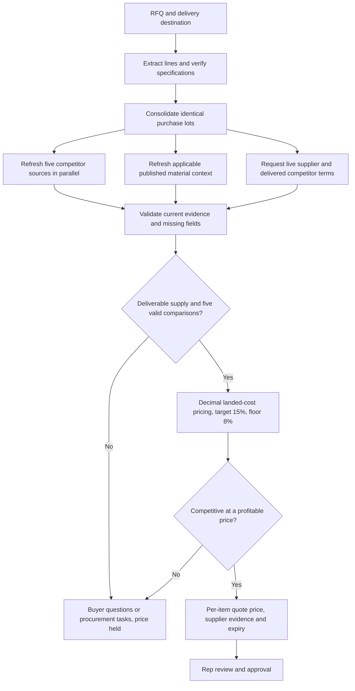

# Live distributor pricing

Public price listings and material indices never establish wholesale cost or confirmed delivery on their own. Rep approval is required; this service does not send or purchase.
