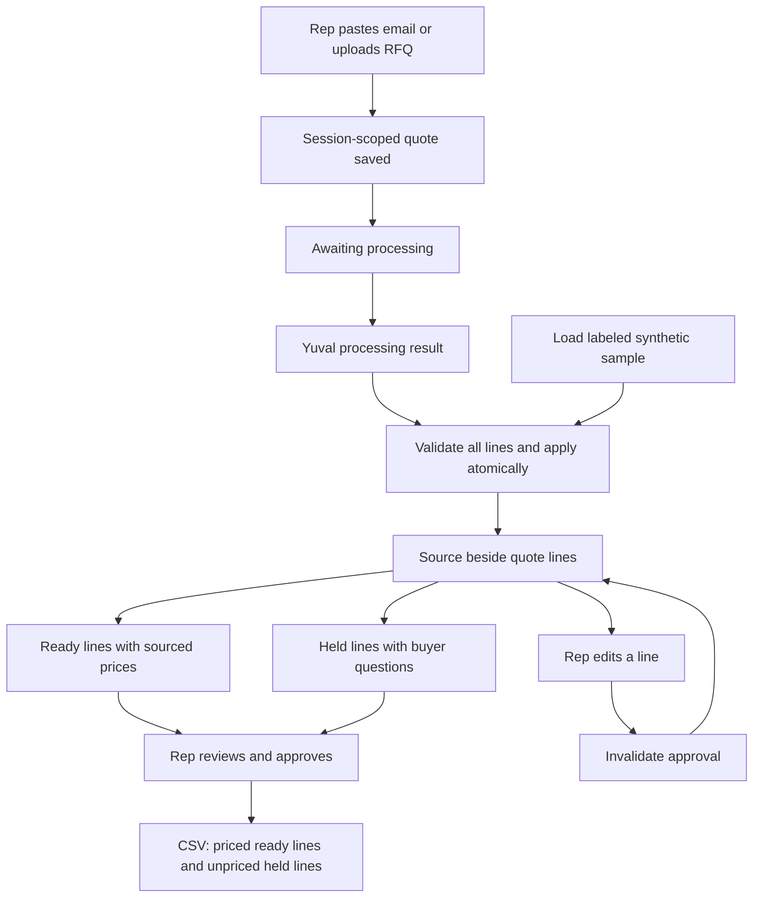

# Quote workspace flow

The processing service is an internal handoff, not yet wired to a provider.
Uploads are stored without invented extraction. Held lines never contribute to
the subtotal. No buyer email is sent. Automated clarification delivery and buyer
responses are a separate pending product decision.
