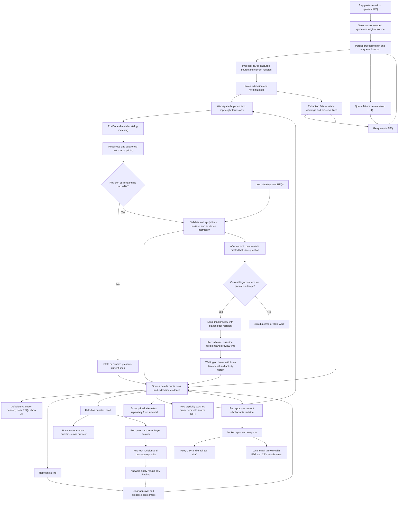

# Quote workspace flow

Saving an RFQ starts processing automatically. Work runs outside the request and
outside the quote lock; result application rechecks revision and rep edits under
that lock. Duplicate active requests reuse one run. The status panel shows queued,
running, succeeded, failed, stale or conflict. Existing lines are not destructively
reprocessed through the manual endpoint. Rep-entered buyer answers selectively rerun one held line under fresh revision guards.

Text-bearing PDF, CSV and pasted text extraction are connected. Unsupported or
textless sources fail visibly. Source filename, page/row counts and bounded warnings
are stored as internal evidence. Rules parsing and RudCo/metals matching are active;
no AI provider is called by this intake path. Rep-taught buyer terms are scoped to
the workspace. Automatically learned memory and aviation matching are excluded from
intake until their contracts are safe.

Held lines never enter the subtotal. Unsupported sale units stay unpriced. Lead
time is sourced or shown as `to confirm`. Filters never change totals or approval
scope. Spec and quantity edits hold lines and clear lead-time evidence. All saved
edits invalidate approval. Downloads and local previews preserve the quote.

Final email text, PDF and CSV use the same approved revision in a local mail preview.
PDF embeds Unicode fonts and rejects unsupported glyphs rather than altering specs.
Constructed provenance stays internal; internal notes and extraction metadata stay out of buyer
exports. Question drafts contain existing held-line questions only. New or changed held questions also queue an automatic local preview after commit. Successful current previews produce a locally labeled waiting state; changed questions clear that state without deleting history. Pending or failed previews never imply success. No quote totals, approval or source bytes change when a preview is recorded.

Email previews use `letter_opener` in development and a test adapter in tests, with
an invalid placeholder recipient. No buyer mail is sent. Real delivery, public choice
responses, confidence-based sending and general re-quote redlines remain pending.

Presentation follows Ken's [style guide](../product/STYLE_GUIDE.md) and the shared
[UI components](../engineering/UI_COMPONENTS.md).
