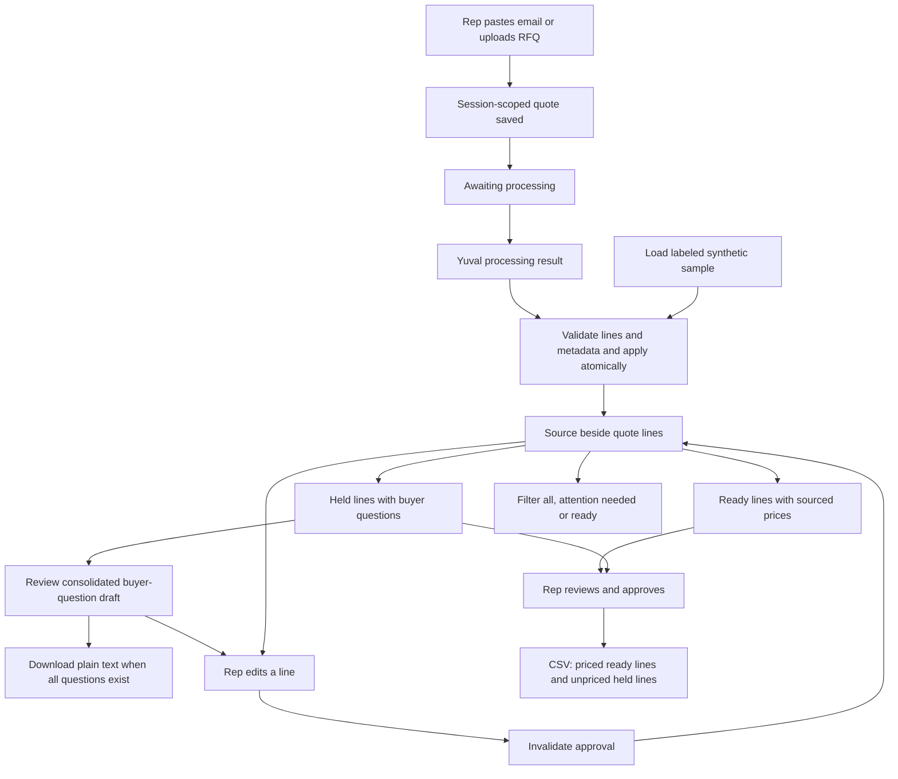

# Quote workspace flow

The processing service is an internal handoff, not yet wired to a provider.
Uploads are stored without invented extraction. Held lines never contribute to
the subtotal. Filters do not change totals or approval scope. Hardware specs,
processing metadata, stable line IDs and the processing revision are stored.
The question preview and draft download do not change the quote or approval.
No buyer email is sent. Ken approved email choices and response behavior in the
demo workflow; delivery, response handling and the confidence gate remain pending.
