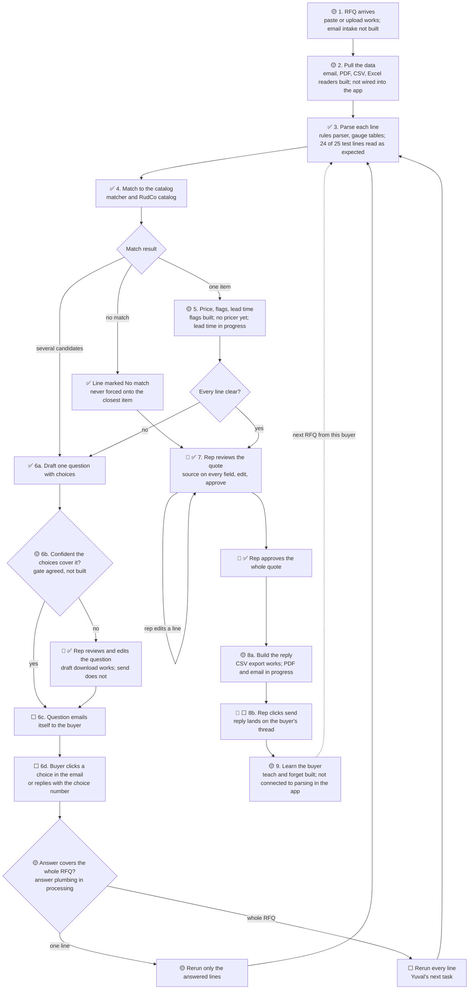

# Build Map

**What this is:** every path through the [demo workflow](WORKFLOW.md), including the loops back for buyer questions and the points where the rep decides, with what is built.

**Checked:** 2026-10-10 13:37, against `main` at commit `5cc142b` and the bulletin board. Owners, correct a mark when you land something.

**Key:**
- ✅ Built and on `main`.
- 🟡 Partly built, or built but not yet connected to the app.
- ⬜ Not started.
- 👤 A rep checkpoint: a person decides here.

## The map

A rerun clears approval and highlights what changed, so a line that turns Ready after a buyer answer goes back through the rep (W3 guard 3, ⬜). A rerun never overwrites a field the rep edited (W3 guard 2, ⬜). Each line keeps its run ID and benchmark date (W3 guard 4, ✅).

## Step by step

| Step | Status | What is there | What is missing | Owner |
|---|---|---|---|---|
| 1. RFQ arrives | 🟡 | Paste or upload an RFQ in the app. **Load sample RFQ** button. Yuval proposed a demo RFQ email (`tools/rfq_processing/spec/fixtures/demo_rfq_email.txt`). | An email inbox that receives RFQs. The final demo email (handed to Tisch, who can start from Yuval's draft). | Hirsh, Tisch |
| 2. Pull the data | 🟡 | Readers for email, PDF (`tools/pdf_text`), CSV, and Excel, in the processing library. | The app calling them when an RFQ comes in. Hirsh is wiring it now. | Yuval, Hirsh |
| 3. Parse | ✅ | Rules parser with per-material gauge tables. 104 specs pass; 24 of 25 test lines read as expected ([test results](../rfq_processing/TEST-RESULTS.md)). | The Claude reading step needs an API key (from the hackathon). | Yuval |
| 4. Match | ✅ | Matcher returns one match, candidates with a question, or no match. 96 RudCo items and 143 metals items. | None for the demo. | Tisch |
| 5. Price, flags, lead time | 🟡 | Compliance flags (MTR, COA, DFARS, REACH, RoHS, and more) with trigger words. RudCo website list prices on RudCo items. | A pricer that prices metals lines against a named, dated benchmark. Lead time per line (Hirsh building). | Tisch, Yuval, Hirsh |
| 6. Buyer questions | 🟡 | Question drafting and download. Answer plumbing in processing. | The confidence gate, sending the email, click-to-answer buttons, and the whole-RFQ rerun. | Hirsh, Yuval |
| 7. Rep review and approve | ✅ | Side-by-side review, source on every field, edits marked as rep edits, approval of the whole quote. | Approval cleared by a rerun (W3 guard 3). | Hirsh |
| 8. Send the reply | 🟡 | CSV export. | The quote PDF and the reply email on the buyer's thread (Hirsh building). | Hirsh |
| 9. Learn the buyer | 🟡 | Per-buyer memory with teach and forget on the catalog matching page. Processing reads learned terms. | The app passing learned terms into processing, and the second-RFQ demo. | Yuval, Tisch, Hirsh |

## The rep checkpoints

1. **Review a question before it sends,** when the agent is not confident the choices cover what the buyer meant.
2. **Review the quote,** line by line, and edit any field.
3. **Approve the whole quote.** Any edit after approval clears it, and so does a rerun.
4. **Click send** on the reply.
