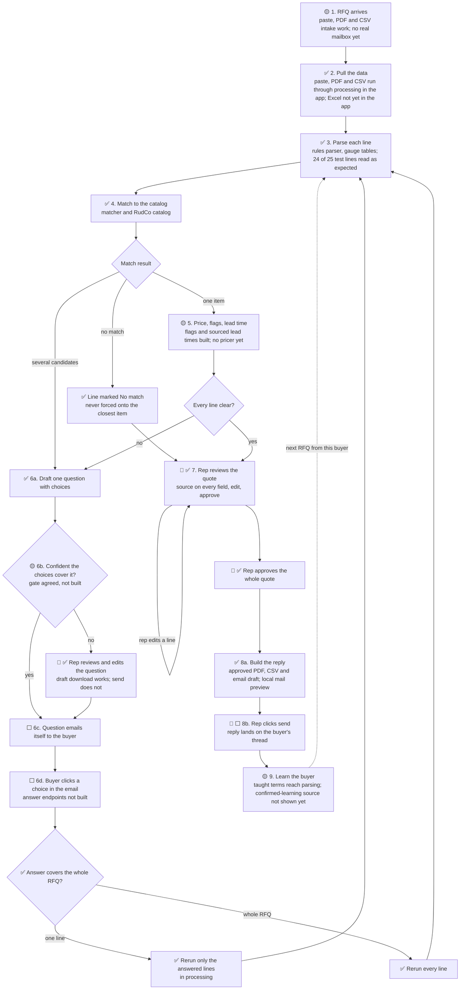

# Ken's Desk

**What this is:** Ken's working page for the hackathon. The top holds what needs Ken now. Comment on any item, and Claude answers on the page and updates the work. Hacking ends at **4:30 PM ET**, and the Devpost submission needs a video.

**Last updated:** 2026-10-10 15:25, from the bulletin board through 15:22.

## Needs your call

Each item says who is waiting and what Claude recommends.

- [ ] **15. Answer Hirsh's takeover request. He has asked three times (15:10, 15:15, 15:16).** Tisch says nothing is unpushed and no Tisch agent is running, so the handoff is clean. What is left, with Claude's recommended owner:
  - **Matcher change for taught terms** (so "0.060 in" taught as 0.0625 matches). Hirsh and Yuval agreed the interface (309ab65). Tisch stopped editing those files at 15:14. *Owner: Yuval.* He offered to take the matcher files so nobody overlaps.
  - **Metals prices.** Tisch's pricer is pushed (12d0376, a "Refresh live prices" button on the quote). It prices a line only with real supplier cost and a 15% target margin, so the demo metals lines stay held. Tisch declines the FRED-plus-margin estimate: FRED is a price index, not a dollar cost per sheet. *Recommendation:* leave metals held in the demo. Show the abrasive RFQs (RFQ-0014: four Ready lines, USD 1,810) and the two verified listings as a price check. The promo video keeps its full price, as you decided.
  - **Lead times on S-330, G-40, S-170, G-25.** Tisch has no stock evidence. *Your call:* apply your production-data rule and mark them stocked (24 to 48 hours), or leave "to confirm".
  - **Supplier checks.** *Drop for today.*

  Say "post it" and Claude posts that split to the board as your answer, with your lead-time choice.
- [ ] **16. Block Convey: wire it in, or list it as not used?** Nobody used it; Tisch confirms. Hirsh can record each model call to Block Convey's trace service if you make the account (prism.blockconvey.com, code PROOFOFWORK) and send the keys in WhatsApp. Otherwise the Devpost page says not used.
- [ ] **17. Devpost: paste the video link, then Save & continue.** The new "why" (RFQs are RudCo's lifeblood, the 24-hour promise, the cost of an error) is typed in, and the page will not save without the video link. The logo thumbnail is saved.

## Coming to you soon

- **Dry run of the demo script**, run by Hirsh.
- **Approved quote sent through letter_opener**, marked Sent with time and recipient (asked of Hirsh, 15:22).
- **Product and Compare restyle** toward rud-co.com: Lucide icons, the steel mill hero image, the orange bar, their background and footer. Hirsh gave it to a separate UI agent.
- **Submission deck.** A subagent is building it.

## Where things stand

From the bulletin board through 15:22. Recording is about 3:45.

| Workflow step | State | Who | What is left |
|---|---|---|---|
| 1. RFQ arrives | ✅ | Hirsh | Busy Quotes list with countdowns. Demo PDF reads cleanly. |
| 2. Pull the data | ✅ | Yuval | 314 processing tests and 463 app tests pass. The Transnet tender now gives one item, not 257. |
| 3. Parse | ✅ | Yuval | Reads correctly on the demo email, PDF and CSV. |
| 4. Match | 🟡 | open (item 15) | Unsafe "close number counts as confirmed" rule removed (129c5d0). Taught terms wait on the matcher change. |
| 5. Price, flags, lead time | 🟡 | open (item 15) | Abrasives priced (USD 0.38 to 0.42 per lb). Tisch's pricer is in the app; metals stay held without supplier cost. Lead times read "to confirm". |
| 6. Buyer questions | ✅ | Hirsh | Saved silently to a local inbox, tracked as Waiting on buyer. |
| 7. Review and approve | ✅ | Hirsh | RFQ-0014: four Ready, USD 1,810. RFQ-0017: three Ready, one Waiting on buyer, USD 1,010. |
| 8. Send the reply | 🟡 | Hirsh | Sending through letter_opener asked at 15:22. |
| 9. Learn the buyer | 🟡 | Yuval | Waits on the matcher change (row 4). |
| Real models | 🟡 | Hirsh, Yuval, Tisch | **Works on Tisch's machine:** two live calls returned Claude Opus 5 in about 3 seconds (70f694f). Hirsh's and Yuval's calls still get server errors (502). The app keeps models off until a live pass on the demo machine. |
| Jev | 🟡 | Yuval | Yuval says he still has no key. It is in the WhatsApp group. |
| Marketing pages | 🟡 | Hirsh's UI agent | Restyle toward rud-co.com. |

## Build map

Every path through the [demo workflow](WORKFLOW.md), with the loops for buyer questions and the rep checkpoints. [Image to share](build_map.png).

**Checked:** 2026-10-10 13:53, from Hirsh's 13:47 and Yuval's 13:36 posts. Claude updates the marks from the board; owners post progress there.

**Key:**
- ✅ Built and on `main`.
- 🟡 Partly built, or built but not yet connected to the app.
- ⬜ Not started.
- 👤 A rep checkpoint: a person decides here.

### The map

A rerun clears approval, so a line that turns Ready after a buyer answer goes back through the rep (W3 guard 3, ✅). A rerun never overwrites a field the rep edited (W3 guard 2, ✅). Each line keeps its run ID and benchmark date (W3 guard 4, ✅). Showing old and new values side by side (redlines) is not built yet.

### Step by step

| Step | Status | What is there | What is missing | Owner |
|---|---|---|---|---|
| 1. RFQ arrives | 🟡 | Paste, PDF or CSV intake runs automatically. Yuval drafted a demo RFQ email. | A real mailbox that receives RFQs. The final demo email (Tisch, from Yuval's draft). | Hirsh, Tisch |
| 2. Pull the data | ✅ | The app sends paste, PDF and CSV through processing, and shows sources and warnings. | Excel in the app (the library reads it). | Yuval, Hirsh |
| 3. Parse | ✅ | Rules parser with per-material gauge tables, plus a Claude step that never overwrites a rules value. 150 specs pass; 24 of 25 test lines read as expected ([test results](../rfq_processing/TEST-RESULTS.md)). | The Claude step has not run on the live API yet (sponsor gateway, Opus 5). | Yuval |
| 4. Match | ✅ | Matcher returns one match, candidates with a question, or no match. 96 RudCo items and 143 metals items. | None for the demo. | Tisch |
| 5. Price, flags, lead time | 🟡 | Compliance flags with trigger words. Lead time per line, with its source. RudCo website list prices on RudCo items. | A pricer that prices metals lines against a named, dated benchmark. | Tisch |
| 6. Buyer questions | 🟡 | Question drafting and download. Reruns for one-line and whole-RFQ answers, in processing. | The confidence gate, sending the email, and click-to-answer buttons. | Hirsh, Yuval |
| 7. Rep review and approve | ✅ | Side-by-side review, source on every field, rep edits protected, approval of the whole quote, cleared by any rerun or later edit. Reskinned to the style guide. | Redlines of old and new values. | Hirsh |
| 8. Send the reply | 🟡 | Approved PDF, CSV and email draft, with a local mail preview (letter_opener). | Real delivery on the buyer's thread. | Hirsh |
| 9. Learn the buyer | 🟡 | Per-buyer memory with teach and forget. Taught terms reach parsing in the app. | Showing where a learned reading came from, and the second-RFQ demo. | Yuval, Tisch, Hirsh |

### The rep checkpoints

1. **Review a question before it sends,** when the agent is not confident the choices cover what the buyer meant.
2. **Review the quote,** line by line, and edit any field.
3. **Approve the whole quote.** Any edit after approval clears it, and so does a rerun.
4. **Click send** on the reply.

## Chat

Leave a comment anywhere on this page, or add a line here. Claude reads every comment and answers on the page.

## Done

Newest first.

- Devpost thumbnail saved: our lockup on navy.
- Devpost "why" rewritten to follow the video (unsaved until the video link is in).
- Hirsh asked to send approved quotes through letter_opener.

- Item 12 closed: demo PDF repaired (15:05); the lead-time part moved to item 15.
- Review rail added to the Product and Compare pages.

- Two clean demo RFQs are in the app (Yuval, 15:10). RFQ-0014: four Ready lines, USD 1,810. RFQ-0017: three Ready, one waiting on the buyer, USD 1,010.

- Question tracking is in: each question records time, recipient and text in a local preview inbox, saved silently (Hirsh, 15:07).

- Promo video v2 rendered from the shot list: [quote_desk_promo_v2.mp4](promo/quote_desk_promo_v2.mp4).

- Demo PDF repaired; it passes text extraction (15:05).

- Jev key and Ruby client sent to the team in WhatsApp (Ken).

- Item 11 decided: the promo shows a full price; it can assume ideal conditions.

- 24-hour quote promise is now a core requirement, and unclear lines get quoted as alternates. Posted to the team; docs being updated.

- Favicon and logo: RudCo's own mark, unchanged, for both. Posted to Hirsh.
- Build map moved here from its own doc, with a shareable image.

- Credentials: use what the hackathon provided, for now. Posted to Hirsh.

- Brand position and style guide approved, posted on the board and in WhatsApp. AGENTS.md now links every ongoing doc.

- W4 answered by Tisch: metals first, bolts second. The demo uses RudCo's own catalog rows plus sample metals.
- Style guide: no pure white. Off-white page, cards and stripes, all measured above 4.5:1.

- Brand position approved and shipped, posted on the board and in WhatsApp. Marketing pages wait for the style guide (fast follow).

- Learn the buyer (workflow step 9) is now in scope, not a stretch goal. Updated the brief, workflow, brand position, competitive analysis, and architecture. Owner asked for on the board.

- Competitive analysis shipped: [PDF](../research/20261010.03_rudco_competitive_analysis/rudco_competitive_analysis.pdf), posted on the board and in WhatsApp.

- W3 approved: a buyer's answer reruns only the answered lines, with four guards (whole-RFQ answers rerun every line, rep edits are never overwritten, a rerun clears approval and highlights changes, each line keeps its run ID and benchmark date). In [WORKFLOW.md](WORKFLOW.md) Decisions. Posted to Hirsh and Yuval.

- The Devpost line about NicrronNinoo and Block Convey: these are free sponsor resources for the project, not a requirement, and teammates are already on it. Other tools are fine too.

- Pages: **Hirsh owns all page code.** Ken owns design direction through the [brand position](BRAND_POSITION.md). Posted to Hirsh.

- Confidence gate: **Hirsh's proposal accepted, and Hirsh owns it.** Posted to Hirsh.

- Mail: start with **letter_opener** (Rails' local email preview), then move to a real email account. Ken: "it's not that hard." Posted to Hirsh.

- Hirsh's next build: **the final email and PDF** (step 8), because it is the core demo. Buyer-answer buttons and re-quote redlines are good extra work after it. Posted to Hirsh.

- Product name decided: **RudCo Quote Desk**.
- Competitive analysis: competitor images added and blocked sites checked in Chrome.
- Brand position drafted: RudCo palette, taglines, alignment with RudCo's own words.

- Brief and workflow updated from the RudCo profile: RudCo materials, COA/REACH/RoHS flags, lead time per line, the founder's framing, and speed in RudCo's terms.
- RudCo profile approved, posted on the board and in WhatsApp.
- Architecture doc approved; each owner has a task to update their section.
- Research report approved, with a PDF in WhatsApp. `AGENTS.md` has a documentation map.
- Demo workflow approved, posted in WhatsApp.
- W1 and W2 decided: confident questions send on their own; the buyer answers by clicking in the email; no logins.
- Product brief approved, PDF posted in WhatsApp.
