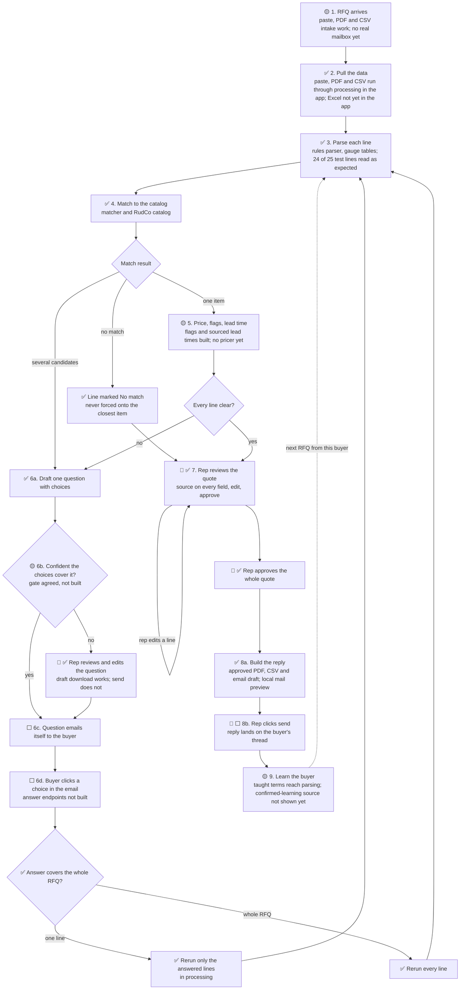

# Ken's Desk

**What this is:** Ken's working page for the hackathon. The top holds what needs Ken now. Comment on any item, and Claude answers on the page and updates the work. Hacking ends at **4:30 PM ET**, and the Devpost submission needs a video.

**Last updated:** 2026-10-10 14:56, from the bulletin board through 14:52.

## Needs your call

Each item says who is waiting and what Claude recommends.

- [ ] **12. Hirsh asks you to step in on Tisch's work** (board, 14:52). Tisch is the bottleneck. Hirsh wants you to take or assign: (a) rebuilding the demo PDF, which is corrupt in the repo, so the PDF path fails; (b) cleaning up source data; (c) stock and lead-time evidence for the four clean-demo SKUs: S-330, G-40, S-170, G-25. *Recommendation:* Claude takes (a) and (b) now, after agreeing exact files with Tisch on the board. For (c), apply your production-data rule: the demo catalog marks those four SKUs as stocked, so they show RudCo's 24 to 48 hour lead time. Hirsh's board note says missing evidence must stay unknown, so this needs your word. Say "go" and which parts.
- [ ] **13. Jev key and Ruby client.** Hirsh (W1 question check) and Yuval (doubtful compliance hits) are waiting on a `JEV_API_KEY` and Herald's client, shared privately. Herald's client is `herald/app/services/classify/jev_client.rb`. Waiting: you.
- [ ] **14. Review the product page and comparison page.** First drafts are up on the running app: [Product](http://127.0.0.1:3100/product) and [Compare](http://127.0.0.1:3100/compare) (Hirsh, 14:38). Leave comments right on the pages.

## Coming to you soon

- **Promo video v2**, built from the shot list, with a full price on the metals line as you asked. A subagent is rendering it.
- **Two clean demo RFQs** (Yuval, 14:50): four abrasive lines (S-330, G-40, S-170, G-25), all Ready with RudCo prices and COA flags; and the same RFQ with one quantity missing, so one line asks the buyer. Hirsh is loading them as demo records.
- **Auto-sent question tracking:** each question shows time, recipient and text, through the local mail preview. Two Hirsh workers on it.
- **Dry run of the demo script at 3:15**, run by Hirsh.

## Where things stand

From the bulletin board through 14:52. Recording is about 3:45.

| Workflow step | State | Who | What is left |
|---|---|---|---|
| 1. RFQ arrives | 🟡 | Hirsh, Tisch | Busy Quotes list done: varied receipt ages, amber under 8 hours, red overdue, soonest due first, sent last. The Northline demo email loads, but the demo PDF is corrupt in the repo. |
| 2. Pull the data | 🟡 | Yuval | Fixes for false items (headers, titles, "Same sheet as last week"), packaging read as quantity, and compliance scope are local, waiting on review before push. The Transnet tender now extracts its one real S390 row. |
| 3. Parse | ✅ | Yuval | Shorthand misreads being fixed: glass bead size vs finish, stainless shot, "16 Gage x 4 x 8". |
| 4. Match | 🟡 | Tisch, Yuval | A taught thickness (0.060 in read as 0.0625) still matches with "close, confirm", so the second RFQ stays held. Needs Tisch's matcher change. |
| 5. Price, flags, lead time | 🟡 | Tisch | RudCo list prices work on abrasives (USD 0.38 to 0.42 per lb). Tisch's distributor pricer is built (98 tests) but now requires five competitor offers per item, so metals stay unpriced. Lead time reads "to confirm" for all 96 RudCo rows (item 12). |
| 6. Buyer questions | ✅ for the demo | Hirsh | Answer "100 lb" on a held S-330 line, and the line turns Ready at USD 0.40 per lb. "Question to send" label is live. Auto-send tracking in progress. |
| 7. Review and approve | ✅ | Hirsh | Evidence pill and in-place line opening done. 400 tests pass. |
| 8. Send the reply | 🟡 | Hirsh | PDF, CSV and email draft with local preview. Real delivery not built. |
| 9. Learn the buyer | 🟡 | Hirsh, Yuval, Tisch | Teaching "0.060 in" as 0.0625 works from the quote form, with the source RFQ saved. Blocked at matching (row 4). |
| Marketing pages | 🟡 | Hirsh | Product and Compare drafts ready for you (item 14). |

## Build map

Every path through the [demo workflow](WORKFLOW.md), with the loops for buyer questions and the rep checkpoints. [Image to share](build_map.png).

**Checked:** 2026-10-10 13:53, from Hirsh's 13:47 and Yuval's 13:36 posts. Claude updates the marks from the board; owners post progress there.

**Key:**
- ✅ Built and on `main`.
- 🟡 Partly built, or built but not yet connected to the app.
- ⬜ Not started.
- 👤 A rep checkpoint: a person decides here.

### The map

A rerun clears approval, so a line that turns Ready after a buyer answer goes back through the rep (W3 guard 3, ✅). A rerun never overwrites a field the rep edited (W3 guard 2, ✅). Each line keeps its run ID and benchmark date (W3 guard 4, ✅). Showing old and new values side by side (redlines) is not built yet.

### Step by step

| Step | Status | What is there | What is missing | Owner |
|---|---|---|---|---|
| 1. RFQ arrives | 🟡 | Paste, PDF or CSV intake runs automatically. Yuval drafted a demo RFQ email. | A real mailbox that receives RFQs. The final demo email (Tisch, from Yuval's draft). | Hirsh, Tisch |
| 2. Pull the data | ✅ | The app sends paste, PDF and CSV through processing, and shows sources and warnings. | Excel in the app (the library reads it). | Yuval, Hirsh |
| 3. Parse | ✅ | Rules parser with per-material gauge tables, plus a Claude step that never overwrites a rules value. 150 specs pass; 24 of 25 test lines read as expected ([test results](../rfq_processing/TEST-RESULTS.md)). | The Claude step has not run on the live API yet (sponsor gateway, Opus 5). | Yuval |
| 4. Match | ✅ | Matcher returns one match, candidates with a question, or no match. 96 RudCo items and 143 metals items. | None for the demo. | Tisch |
| 5. Price, flags, lead time | 🟡 | Compliance flags with trigger words. Lead time per line, with its source. RudCo website list prices on RudCo items. | A pricer that prices metals lines against a named, dated benchmark. | Tisch |
| 6. Buyer questions | 🟡 | Question drafting and download. Reruns for one-line and whole-RFQ answers, in processing. | The confidence gate, sending the email, and click-to-answer buttons. | Hirsh, Yuval |
| 7. Rep review and approve | ✅ | Side-by-side review, source on every field, rep edits protected, approval of the whole quote, cleared by any rerun or later edit. Reskinned to the style guide. | Redlines of old and new values. | Hirsh |
| 8. Send the reply | 🟡 | Approved PDF, CSV and email draft, with a local mail preview (letter_opener). | Real delivery on the buyer's thread. | Hirsh |
| 9. Learn the buyer | 🟡 | Per-buyer memory with teach and forget. Taught terms reach parsing in the app. | Showing where a learned reading came from, and the second-RFQ demo. | Yuval, Tisch, Hirsh |

### The rep checkpoints

1. **Review a question before it sends,** when the agent is not confident the choices cover what the buyer meant.
2. **Review the quote,** line by line, and edit any field.
3. **Approve the whole quote.** Any edit after approval clears it, and so does a rerun.
4. **Click send** on the reply.

## Chat

Leave a comment anywhere on this page, or add a line here. Claude reads every comment and answers on the page.

## Done

Newest first.

- Item 11 decided: the promo shows a full price; it can assume ideal conditions.

- 24-hour quote promise is now a core requirement, and unclear lines get quoted as alternates. Posted to the team; docs being updated.

- Favicon and logo: RudCo's own mark, unchanged, for both. Posted to Hirsh.
- Build map moved here from its own doc, with a shareable image.

- Credentials: use what the hackathon provided, for now. Posted to Hirsh.

- Brand position and style guide approved, posted on the board and in WhatsApp. AGENTS.md now links every ongoing doc.

- W4 answered by Tisch: metals first, bolts second. The demo uses RudCo's own catalog rows plus sample metals.
- Style guide: no pure white. Off-white page, cards and stripes, all measured above 4.5:1.

- Brand position approved and shipped, posted on the board and in WhatsApp. Marketing pages wait for the style guide (fast follow).

- Learn the buyer (workflow step 9) is now in scope, not a stretch goal. Updated the brief, workflow, brand position, competitive analysis, and architecture. Owner asked for on the board.

- Competitive analysis shipped: [PDF](../research/20261010.03_rudco_competitive_analysis/rudco_competitive_analysis.pdf), posted on the board and in WhatsApp.

- W3 approved: a buyer's answer reruns only the answered lines, with four guards (whole-RFQ answers rerun every line, rep edits are never overwritten, a rerun clears approval and highlights changes, each line keeps its run ID and benchmark date). In [WORKFLOW.md](WORKFLOW.md) Decisions. Posted to Hirsh and Yuval.

- The Devpost line about NicrronNinoo and Block Convey: these are free sponsor resources for the project, not a requirement, and teammates are already on it. Other tools are fine too.

- Pages: **Hirsh owns all page code.** Ken owns design direction through the [brand position](BRAND_POSITION.md). Posted to Hirsh.

- Confidence gate: **Hirsh's proposal accepted, and Hirsh owns it.** Posted to Hirsh.

- Mail: start with **letter_opener** (Rails' local email preview), then move to a real email account. Ken: "it's not that hard." Posted to Hirsh.

- Hirsh's next build: **the final email and PDF** (step 8), because it is the core demo. Buyer-answer buttons and re-quote redlines are good extra work after it. Posted to Hirsh.

- Product name decided: **RudCo Quote Desk**.
- Competitive analysis: competitor images added and blocked sites checked in Chrome.
- Brand position drafted: RudCo palette, taglines, alignment with RudCo's own words.

- Brief and workflow updated from the RudCo profile: RudCo materials, COA/REACH/RoHS flags, lead time per line, the founder's framing, and speed in RudCo's terms.
- RudCo profile approved, posted on the board and in WhatsApp.
- Architecture doc approved; each owner has a task to update their section.
- Research report approved, with a PDF in WhatsApp. `AGENTS.md` has a documentation map.
- Demo workflow approved, posted in WhatsApp.
- W1 and W2 decided: confident questions send on their own; the buyer answers by clicking in the email; no logins.
- Product brief approved, PDF posted in WhatsApp.
