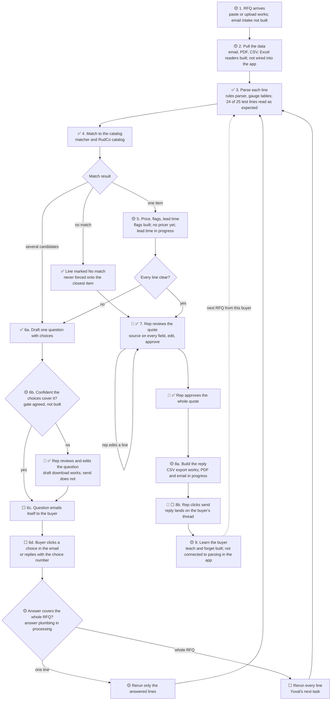

# Ken's Desk

**What this is:** Ken's working page for the hackathon. The top holds what needs Ken now. Comment on any item, and Claude answers on the page and updates the work. Hacking ends at **4:30 PM ET**, and the Devpost submission needs a video.

**Last updated:** 2026-10-10 13:52, from the bulletin board through Hirsh's 13:40 post.

## Needs your call

Each item says who is waiting and what Claude recommends.

Nothing open.

## See the demo now

Hirsh, 13:28. In the repo on your machine, run `git pull origin main`, then `script/setup`, then `script/dev`. Open http://127.0.0.1:3100 and click **Load sample RFQ**. You can review, edit, approve, and export CSV. The catalog matching page is there too. The PDF, email, and automatic intake are not pushed yet.

## Coming to you soon

- **The demo RFQ email.** Handed to Tisch, who has been collecting the RFQ and catalog data. Yuval checks that every line parses.
- **The app reskin to the style guide, and a shared component library.** Asked the team on the board; Hirsh leads both.

## Where things stand

From the bulletin board through 13:40.

| Area | Owner | State |
|---|---|---|
| Quote app | Hirsh | Three agents running: one reskins every page to the style guide and builds the shared components, one finishes automatic RFQ intake, one reviews Tisch's matcher against the app. 284 app tests pass. Next up from your notes: seed RFQs, the L3 logo and favicon, no disclaimers. |
| RFQ processing | Yuval | Buyer-answer reruns are on main: one-line answers rerun that line, whole-RFQ answers rerun all. Excel intake and the Claude reading step are in; the Claude step has not run against the live API yet. 150 specs pass; 24 of 25 test lines read as the research expects. |
| Matching and pricing | Tisch | Fixed Hirsh's matcher points: real part forms, part numbers, a contract for Yuval, safer approvals. Writing the demo RFQ email (from Yuval's draft). **Still no pricer** for metals lines. |
| API key | Hirsh | Using the hackathon's sponsor gateway (Nicrron). The key is shared privately and kept out of the repo. |
| Product docs | Ken | All shipped and approved. PDFs of each are linked from the [README](../../README.md#documents). |
| Demo video | Ken | Not started. Yuval's plan has it recorded between 3:45 and 4:30. |

**Two things from the board for you:**

- **Hirsh requires Opus 5, not Opus 5.5, for every Claude process** (13:40), because the sponsor gateway lists Opus 5 only. This session runs Opus 5.5. Say if you want it switched.
- **Hirsh says the demo prices are synthetic** and need a sourced replacement before they can show as real (13:33). That pulls against your call to build for production data. The fix that keeps both: Tisch's pricer, which prices from a named, dated benchmark.

## Build map

Every path through the [demo workflow](WORKFLOW.md), with the loops for buyer questions and the rep checkpoints. [Image to share](build_map.png).

**Checked:** 2026-10-10 13:37, against `main` at commit `5cc142b` and the bulletin board. Claude updates the marks from the board; owners post progress there.

**Key:**
- ✅ Built and on `main`.
- 🟡 Partly built, or built but not yet connected to the app.
- ⬜ Not started.
- 👤 A rep checkpoint: a person decides here.

### The map

A rerun clears approval and highlights what changed, so a line that turns Ready after a buyer answer goes back through the rep (W3 guard 3, ⬜). A rerun never overwrites a field the rep edited (W3 guard 2, ⬜). Each line keeps its run ID and benchmark date (W3 guard 4, ✅).

### Step by step

| Step | Status | What is there | What is missing | Owner |
|---|---|---|---|---|
| 1. RFQ arrives | 🟡 | Paste or upload an RFQ in the app. **Load sample RFQ** button. Yuval proposed a demo RFQ email (`tools/rfq_processing/spec/fixtures/demo_rfq_email.txt`). | An email inbox that receives RFQs. The final demo email (handed to Tisch, who can start from Yuval's draft). | Hirsh, Tisch |
| 2. Pull the data | 🟡 | Readers for email, PDF (`tools/pdf_text`), CSV, and Excel, in the processing library. | The app calling them when an RFQ comes in. Hirsh is wiring it now. | Yuval, Hirsh |
| 3. Parse | ✅ | Rules parser with per-material gauge tables. 104 specs pass; 24 of 25 test lines read as expected ([test results](../rfq_processing/TEST-RESULTS.md)). | The Claude reading step needs an API key (from the hackathon). | Yuval |
| 4. Match | ✅ | Matcher returns one match, candidates with a question, or no match. 96 RudCo items and 143 metals items. | None for the demo. | Tisch |
| 5. Price, flags, lead time | 🟡 | Compliance flags (MTR, COA, DFARS, REACH, RoHS, and more) with trigger words. RudCo website list prices on RudCo items. | A pricer that prices metals lines against a named, dated benchmark. Lead time per line (Hirsh building). | Tisch, Yuval, Hirsh |
| 6. Buyer questions | 🟡 | Question drafting and download. Answer plumbing in processing. | The confidence gate, sending the email, click-to-answer buttons, and the whole-RFQ rerun. | Hirsh, Yuval |
| 7. Rep review and approve | ✅ | Side-by-side review, source on every field, edits marked as rep edits, approval of the whole quote. | Approval cleared by a rerun (W3 guard 3). | Hirsh |
| 8. Send the reply | 🟡 | CSV export. | The quote PDF and the reply email on the buyer's thread (Hirsh building). | Hirsh |
| 9. Learn the buyer | 🟡 | Per-buyer memory with teach and forget on the catalog matching page. Processing reads learned terms. | The app passing learned terms into processing, and the second-RFQ demo. | Yuval, Tisch, Hirsh |

### The rep checkpoints

1. **Review a question before it sends,** when the agent is not confident the choices cover what the buyer meant.
2. **Review the quote,** line by line, and edit any field.
3. **Approve the whole quote.** Any edit after approval clears it, and so does a rerun.
4. **Click send** on the reply.

## Chat

Leave a comment anywhere on this page, or add a line here. Claude reads every comment and answers on the page.

## Done

Newest first.

- Favicon and logo: RudCo's own mark, unchanged, for both. Posted to Hirsh.
- Build map moved here from its own doc, with a shareable image.

- Credentials: use what the hackathon provided, for now. Posted to Hirsh.

- Brand position and style guide approved, posted on the board and in WhatsApp. AGENTS.md now links every ongoing doc.

- W4 answered by Tisch: metals first, bolts second. The demo uses RudCo's own catalog rows plus sample metals.
- Style guide: no pure white. Off-white page, cards and stripes, all measured above 4.5:1.

- Brand position approved and shipped, posted on the board and in WhatsApp. Marketing pages wait for the style guide (fast follow).

- Learn the buyer (workflow step 9) is now in scope, not a stretch goal. Updated the brief, workflow, brand position, competitive analysis, and architecture. Owner asked for on the board.

- Competitive analysis shipped: [PDF](../research/20261010.03_rudco_competitive_analysis/rudco_competitive_analysis.pdf), posted on the board and in WhatsApp.

- W3 approved: a buyer's answer reruns only the answered lines, with four guards (whole-RFQ answers rerun every line, rep edits are never overwritten, a rerun clears approval and highlights changes, each line keeps its run ID and benchmark date). In [WORKFLOW.md](WORKFLOW.md) Decisions. Posted to Hirsh and Yuval.

- The Devpost line about NicrronNinoo and Block Convey: these are free sponsor resources for the project, not a requirement, and teammates are already on it. Other tools are fine too.

- Pages: **Hirsh owns all page code.** Ken owns design direction through the [brand position](BRAND_POSITION.md). Posted to Hirsh.

- Confidence gate: **Hirsh's proposal accepted, and Hirsh owns it.** Posted to Hirsh.

- Mail: start with **letter_opener** (Rails' local email preview), then move to a real email account. Ken: "it's not that hard." Posted to Hirsh.

- Hirsh's next build: **the final email and PDF** (step 8), because it is the core demo. Buyer-answer buttons and re-quote redlines are good extra work after it. Posted to Hirsh.

- Product name decided: **RudCo Quote Desk**.
- Competitive analysis: competitor images added and blocked sites checked in Chrome.
- Brand position drafted: RudCo palette, taglines, alignment with RudCo's own words.

- Brief and workflow updated from the RudCo profile: RudCo materials, COA/REACH/RoHS flags, lead time per line, the founder's framing, and speed in RudCo's terms.
- RudCo profile approved, posted on the board and in WhatsApp.
- Architecture doc approved; each owner has a task to update their section.
- Research report approved, with a PDF in WhatsApp. `AGENTS.md` has a documentation map.
- Demo workflow approved, posted in WhatsApp.
- W1 and W2 decided: confident questions send on their own; the buyer answers by clicking in the email; no logins.
- Product brief approved, PDF posted in WhatsApp.
