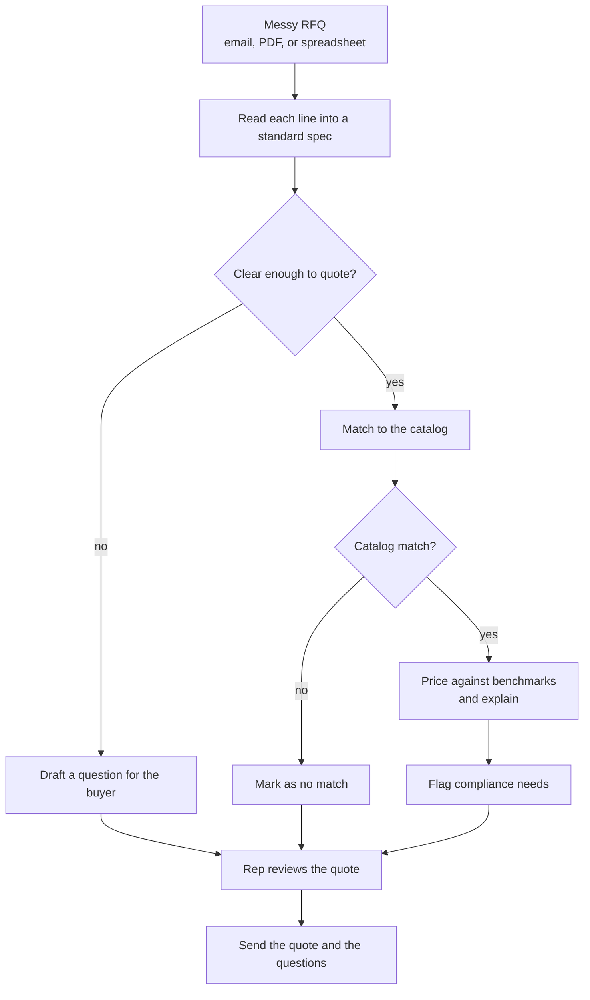

# RFQ to Quote: Product Brief

**Status:** Approved by Ken, 2026-10-10. Every agent reads this before building.

**Product name:** RudCo Quote Desk. Look, voice, and taglines are in the [brand position](BRAND_POSITION.md).

**Read with:** [the bulletin board](../BULLETIN.md) (who is doing what), [AGENTS.md](../../AGENTS.md) (team rules), and the [Devpost page](https://get-hired-hack-nyc.devpost.com/) (the challenge and the rules).

## Open questions

- **Q1. Where does the catalog and price data come from?** RudCo gave no sample catalog or benchmark prices on the Devpost page. If they give us data at the event, we use it. If not, we build a small catalog and price table and label them as sample data on screen. Yuval is finding this out.
- **Q2. What is our sharper angle?** Uniqueness is a quarter of the score. Candidates are under [A sharper angle](#a-sharper-angle). Ken picks one once the [research](../research/20261010.01_rfq_sharper_angle/) lands.

---

## Charter

**What belongs here:**

- What we are building, who it is for, and the problem it solves.
- How the hackathon judges it, and what we must show.
- The principles for choosing which methods to use.
- The commitments we will not trade away.

**What does not:**

- How anything works. That goes in an architecture doc and `docs/diagrams/`.
- Screen designs. Those go in `docs/design/`.
- The task list. That lives on the [bulletin board](../BULLETIN.md).

**Level of detail:** a teammate (or their agent) should finish this document knowing what we are building and why, so every call they make during the day pulls the same direction.

---

## What it is

An agent that reads a messy request for quote (RFQ) and drafts a quote that is ready to send. A buyer's email, PDF, or spreadsheet goes in. A priced quote comes out, line by line. Each line shows where its answer came from.

When a line is unclear, the agent does not guess. It writes the buyer a short, specific question and holds that line until the buyer answers.

## Who it is for

**The quoting rep at an industrial supplier like RudCo.** RudCo supplies metals, abrasives, and aggregates to industrial buyers ([Columbia startup directory](https://entrepreneurship.columbia.edu/?p=81629)). The rep gets RFQs all day from buyers who each write the same item their own way. The rep's job is to send back an accurate, competitive quote fast, before a competitor does.

RudCo's founder puts the rep's role this way: people stay central, and technology gives them "better information for the conversation" (founder interview, via the [RudCo profile](../research/20261010.02_rudco_profile/rudco_profile.md)). Our framing for the pitch: **the agent prepares the conversation, and the rep owns it.**

**The buyer** is the second user. They see the finished quote and any clarifying questions. They never see the agent's working.

**The RudCo judges** are the third audience. RudCo wrote the challenge and judges it ([Devpost](https://get-hired-hack-nyc.devpost.com/)). The founder is likely on the floor; that is an inference from the Devpost text ([RudCo profile](../research/20261010.02_rudco_profile/rudco_profile.md#team)). They know their catalog and their buyers. They will test it against real cases, so accuracy on their own materials matters more than polish ([the hackathon](#the-hackathon)).

## The problem

The same item arrives written five ways:

- "304 SS sheet 16ga 4x8"
- "Stainless 304, 0.060 in, 48 x 96"

Before the rep can price either line, they have to work out:

- the material and grade
- the thickness, which a gauge number only implies, and gauge tables differ by material
- the size in one unit
- the spec standard, such as ASTM A240
- the certifications the buyer needs

Today a person decodes every line by hand. It is slow, and a wrong guess on grade or thickness becomes a wrong quote, a lost order, or a return.

The job the rep needs done:

> Turn this RFQ into a quote I can trust and send. Show me how you read each line. Ask the buyer when you are not sure.

## The hackathon

**When:** Saturday, October 10, 2026. Hacking runs 11:15 AM to 4:30 PM ET. Devpost submissions are due at 4:30 PM, with a video demo. Live demos run 4:30 to 6:00 PM.

**Theme: AI You Can Trust.** Grounded in real data, honest about what it does not know, and clear about how it got its answer.

**How we are scored**, out of 5 each:

| Criterion | What the judges ask | What that means for us |
|---|---|---|
| Technical Execution | Does it work, and does it get the right answer? Judges test it against real cases. | Accuracy beats feature count. A few line types parsed right beat many parsed loosely. |
| Trust & Explainability | Can a user see why the AI said what it said? Does it flag what it does not know? | Every field links back to the words it came from. Every price shows its benchmark. Unclear lines become questions. |
| Design | Could the user run it tomorrow without a walkthrough? | Build for the rep, not for engineers. One screen: the RFQ beside the quote. |
| Uniqueness of Idea | Did you find a sharper angle? | See [A sharper angle](#a-sharper-angle). |

**Not wanted:** slide decks with no product, thin prompt wrappers, or anything built before 11:15 AM.

## The job to be done

> Send the buyer an accurate, competitive quote, faster than competitors.

The three parts, in priority order. The order comes from the research: accuracy first, then speed. Competitive sits second because it is RudCo's own theme.

| # | Value prop | What it means | Proof the demo shows | Workflow step |
|---|---|---|---|---|
| 1 | **Accurate** | Each line is read right, matched to an item RudCo stocks, and carries the paperwork the buyer needs: MTR, COA, country of origin, DFARS, REACH, RoHS. | Click the stainless line: "16 ga" reads as 0.0625 in, with the stainless gauge table named. A hidden-requirement flag shows its trigger word. A line with no fit says "No match" instead of grabbing the closest item. | [3 Parse](WORKFLOW.md#3-parse-each-line-into-a-standard-spec), [4 Match](WORKFLOW.md#4-match-each-line-to-the-catalog), [5 Flags](WORKFLOW.md#5-price-flag-compliance-list-assumptions) |
| 2 | **Competitive** | The price holds up, and the quote says why. | Each price sits beside a named, dated benchmark. The line says the price tracks published metal cost plus RudCo's margin. No benchmark means no price: the line is held. | [5 Price](WORKFLOW.md#5-price-flag-compliance-list-assumptions) |
| 3 | **Faster** | The rep checks a draft instead of decoding every line. Clear lines keep moving while one line waits on the buyer. Each line shows a lead time, so the buyer has a ship date with the price. | The question email goes out, the buyer clicks a choice, and the line turns Ready. Each line shows its lead time: stocked lines use RudCo's 24 to 48 hour promise, anything else says "to confirm". The rep approves and the reply lands on the buyer's thread. | [5 Lead time](WORKFLOW.md#5-price-flag-compliance-list-assumptions), [6 Questions](WORKFLOW.md#6-send-clarifying-questions-to-the-buyer), [7 Approve](WORKFLOW.md#7-present-the-final-quote-for-approval), [8 Send](WORKFLOW.md#8-send-the-quote-back-to-the-buyer) |

On speed, we use RudCo's own terms, as [How we know it works](#how-we-know-it-works) does. Their quote form promises a reply "within 24 hours", and their FAQ says "Stocked lines ship in 24–48 hours" ([site code](https://www.rud-co.com/assets/index-B04wKX3n.js)). The demo line is: RudCo promises a quote within 24 hours; watch the agent draft it in minutes ([WORKFLOW video, step 1](WORKFLOW.md#the-video-demo-in-order)). That line holds only if the video shows the draft in minutes. Every win-rate number about fast quotes comes from a vendor selling quoting software ([sharper-angle report, 6.3](../research/20261010.01_rfq_sharper_angle/report_rfq_sharper_angle.md#63-the-value-props-ranked)), so we do not use one.

## What it does

These come from RudCo's challenge, in order.

1. **Read each line into a standard spec.** Material, grade, dimensions, quantity, and standard (such as ASTM).
2. **Match each line to the supplier catalog.** Find the item RudCo actually stocks, or say there is no match.
3. **Price each line against market benchmarks.** Then explain, in a sentence, why the price is competitive. Each line also carries a lead time, because buyers' RFQs ask for a delivery date and RudCo promises 24 to 48 hour shipping on stocked lines (per the [RudCo profile](../research/20261010.02_rudco_profile/rudco_profile.md)).
4. **Flag compliance requirements.** Mill test reports, certificates of analysis, country of origin, DFARS, REACH and RoHS, and spec certifications, whether the buyer asked for them outright or the spec implies them. RudCo already promises customers this paperwork ("PO→COA/MTR" and "DFARS/REACH/RoHS flags", per the [RudCo profile](../research/20261010.02_rudco_profile/rudco_profile.md)).
5. **Ask instead of guess.** Send any unclear line back to the buyer with one clarifying question.
6. **Learn the buyer.** When the rep confirms how a buyer writes an item, the next RFQ from that buyer reads it that way, and the line says where the reading came from. This is our own addition to the challenge. It is how we beat Proton and Canals, which claim to learn shorthand but do not show the source ([workflow step 9](WORKFLOW.md#9-learn-the-buyer)).

**Stretch, if we get there:** suggest the margin on each line, not only the benchmark price. The rep still owns the final number.

## What the user sees

1. The rep drops in an RFQ: pasted email text, a PDF, or a spreadsheet.
2. The agent lists every line it found, each as a standard spec.
3. Each line shows a status:
   - **Ready:** read, matched, and priced
   - **Needs the buyer:** unclear, with the question drafted
   - **No match:** nothing in the catalog fits
4. The rep clicks any field to see the words in the RFQ it came from, and why the agent read it that way.
5. The rep edits anything, then exports the quote and the buyer questions together.

## What it is not

- **An auto-sender.** The rep approves every quote. The agent drafts.
- **A general chatbot.** The product is the quote, not a chat box. Idea: the rep edits the quote in place and leaves a note on any line for the agent to act on, the way [LAHE](https://github.com/kenxle/live-agentic-html-editor) works.
- **A supplier search across the market.** It matches against one supplier's catalog.

## How it is different

every field links to the buyer's own words and the table or rule used to read them. Every price sits beside a named, dated benchmark. Paperwork the buyer needs gets flagged with the trigger words highlighted: mill test reports, certificates of analysis, country of origin, DFARS, REACH and RoHS ([WORKFLOW step 5](WORKFLOW.md#5-price-flag-compliance-list-assumptions)). An unclear line becomes one question to the buyer with choices to click ([sharper-angle report, section 5](../research/20261010.01_rfq_sharper_angle/report_rfq_sharper_angle.md#5-researchers-position)). None of the AI quote tools we read shows field-level sources, buyer-facing questions, or spec-implied certification flags on its public pages ([competitive analysis](../research/20261010.03_rudco_competitive_analysis/competitive_analysis.md#ai-quote-tools-for-distributors)).

**Why believe it:** the judges can check any line themselves. Click a field and see its source. The rep approves every quote, which matches the founder's view: "Technology can handle more of the coordination and give those people better information for the conversation." ([Digital Journal](https://www.digitaljournal.com/article/ai-infrastructure-boom-reshapes-industrial-materials-procurement/)).

What competitors claim, from the [competitive analysis](../research/20261010.03_rudco_competitive_analysis/competitive_analysis.md#where-rudco-can-get-ahead). Claims are from their own pages and were not tested.

| What competitors claim | What Quote Desk shows that they do not |
|---|---|
| AI quote tools (Avent, Hexa, Mercura, Proton) turn messy RFQs into draft quotes for a rep to approve ([sharper-angle report, 6.7](../research/20261010.01_rfq_sharper_angle/report_rfq_sharper_angle.md#67-what-existing-tools-already-do)). The nearest thing to showing work is a confidence score ([Cassidy](https://www.cassidyai.com/solutions/ai-rfq-data-extraction-agent)) or a low-confidence flag ([Proton](https://www.proton.ai/order-and-quote-automation)). | Each field linked to the buyer's own words and the gauge table or rule used. |
| Service centers offer mill test reports as downloads after purchase ([CSW page on Ryerson.com](https://centralsteel.com/home/customerservice/faq), [Yarde](https://www.yarde.com/)). | The paperwork a spec implies, flagged at quote time, with the trigger words highlighted. This extends what RudCo already sells: "PO→COA/MTR" traceability and "DFARS/REACH/RoHS flags" ([site code](https://www.rud-co.com/assets/index-B04wKX3n.js)). |
| Online stores assume the buyer knows the exact item. AI tools send open questions to an internal reviewer ([competitive analysis](../research/20261010.03_rudco_competitive_analysis/competitive_analysis.md#where-rudco-can-get-ahead)). | One question to the buyer, with choices to click. |
| Steel shot makers and abrasive distributors route quotes to a phone line or a contact form ([N.T. Ruddock](https://www.ntruddock.com/), [Winoa](https://www.winoa.com/)). | An emailed steel shot or aluminum ingot request turned into a draft quote, using RudCo's own product lines. |
| Marketplaces publish indices from their own trades ([competitive analysis](../research/20261010.03_rudco_competitive_analysis/competitive_analysis.md#where-rudco-can-get-ahead)). We found no distributor quote that names a benchmark per line. | A named, dated benchmark and a one-sentence reason on every priced line. |

## A sharper angle

Candidates for the uniqueness score. Ken picks one (Q2).

- **The quote shows its work.** Every number on the quote links back to the phrase in the RFQ it came from. The rep can check the whole quote by hovering, without rereading the email.
- **Questions that close the deal.** Instead of "please clarify," the agent offers the buyer choices: "Your line 3 says 16 gauge. Do you need 16 gauge, or exactly 0.060 in? Both are in stock." The buyer answers with one click.
- **Learns the buyer's shorthand.** Once the rep confirms how a buyer writes an item, the next RFQ from that buyer reads it right the first time, and says so.
- **Catches the hidden requirements.** Some specs imply certifications the buyer never wrote down, such as a mill test report for a pressure-vessel grade. The agent flags these and says why.

## The principles for choosing which methods to use

We blend fixed rules and AI judgment, so the system is accurate where it can be and still handles messy text.

- **Fixed rules** do unit conversion, gauge-to-thickness lookup, dimension parsing, price math, and the rule for when a line is ready.
- **Matching and scoring** pick the catalog item and score how sure we are, using decision engines like Jev.
- **The LLM** reads the messy text into fields, drafts the buyer questions, and writes the price explanation.

Not everything goes to an LLM. A number that can be looked up or computed is looked up or computed.

## Commitments

These hold for every part of the build.

- **Show the source.** Every field traces to the words in the RFQ, and every price traces to a named benchmark.
- **Ask, don't guess.** A line the agent is not sure about becomes a question, never a quiet assumption.
- **Say when data is sample data.** If we built the catalog or the prices ourselves, the screen says so.
- **Accuracy first.** We cannot have hallucinated pricing. 0% mistakes on this front.
- **Keep it demoable.** `main` runs end to end at every push, so the video can be recorded at any point.

## How we know it works

The job has one test, and each thing it does has one, run against our test RFQs.

- **The job.** On our test RFQs, the rep goes from RFQ to a quote they would send in a few clicks, and every line is right. In RudCo's terms: their quote form promises a reply within 24 hours today, and the agent drafts it in minutes.
- **Read each line.** On our test RFQs, every line comes out with the right material, grade, size, quantity, and standard.
- **Match to the catalog.** Each ready line points at the right catalog item. Lines with no fit are marked no match, never forced onto the closest item.
- **Price and explain.** Each price sits next to its benchmark, and the explanation names that benchmark.
- **Flag compliance.** Every certification the test RFQs require, stated or implied, shows up as a flag.
- **Ask, don't guess.** Every line we planted as ambiguous comes back as a question. No clear line gets a question it did not need.

## Decisions

- **A person reviews every quote before it goes out** (2026-10-10). The user is the supplier's quoting rep. The agent drafts; the rep checks, edits, and sends. The buyer only sees the finished quote and the questions.
- **Clarifying questions can send on their own** (2026-10-10). When the agent is confident about the choices to offer, it emails the buyer without review. The buyer answers by clicking a choice in the email. The rep still approves every final quote. Details in [WORKFLOW.md](WORKFLOW.md).
