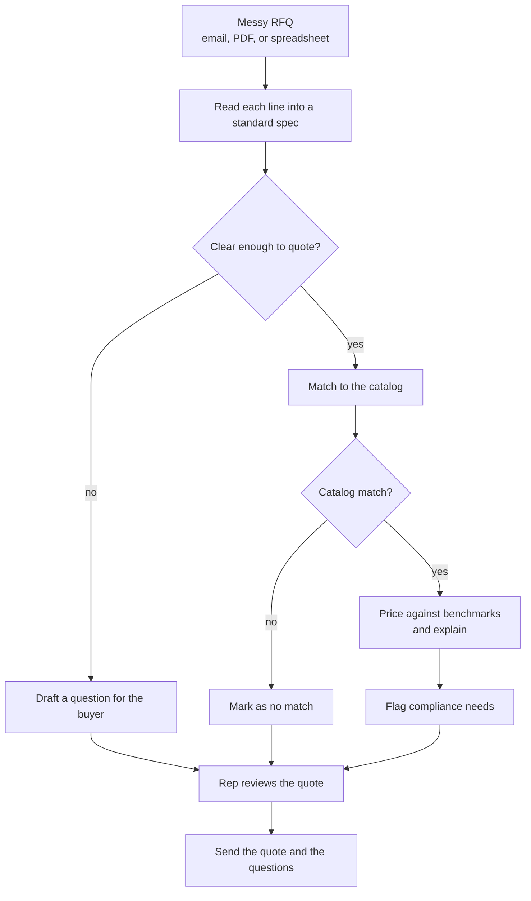

# RFQ to Quote: Product Brief

**Status:** Draft for Ken's review.

**Read with:** [the bulletin board](../BULLETIN.md) (who is doing what), [AGENTS.md](../../AGENTS.md) (team rules), and the [Devpost page](https://get-hired-hack-nyc.devpost.com/) (the challenge and the rules).

## Open questions

- **Q1. Where does the catalog and price data come from?** RudCo gave no sample catalog or benchmark prices on the Devpost page. If they give us data at the event, we use it. If not, we build a small catalog and price table and label them as sample data on screen. Ken: ask the RudCo founder on the floor.
- **Q2. What is our sharper angle?** Uniqueness is a quarter of the score. Candidates are under [A sharper angle](#a-sharper-angle). Ken picks one.
- **Q3. Is the user RudCo's own quoting rep?** This brief assumes the rep reviews every quote before it goes out, and the buyer only sees the finished quote and the questions. Confirm with RudCo.

---

## Charter

**What belongs here:**

- What we are building, who it is for, and the problem it solves.
- How the hackathon judges it, and what we must show.
- The principles for choosing which methods to use.
- The commitments we will not trade away.

**What does not:**

- How anything works. That goes in an architecture doc and `docs/diagrams/`.
- Screen designs. Those go in `docs/design/`.
- The task list. That lives on the [bulletin board](../BULLETIN.md).

**Level of detail:** a teammate (or their agent) should finish this document knowing what we are building and why, so every call they make during the day pulls the same direction.

---

## What it is

An agent that reads a messy request for quote (RFQ) and drafts a quote that is ready to send. A buyer's email, PDF, or spreadsheet goes in. A priced quote comes out, line by line. Each line shows where its answer came from.

When a line is unclear, the agent does not guess. It writes the buyer a short, specific question and holds that line until the buyer answers.

## Who it is for

**The quoting rep at an industrial supplier like RudCo.** RudCo supplies metals, abrasives, and aggregates to industrial buyers ([Columbia startup directory](https://entrepreneurship.columbia.edu/?p=81629)). The rep gets RFQs all day from buyers who each write the same item their own way. The rep's job is to send back an accurate, competitive quote fast, before a competitor does.

**The buyer** is the second user. They see the finished quote and any clarifying questions. They never see the agent's working.

## The problem

The same item arrives written five ways:

- "304 SS sheet 16ga 4x8"
- "Stainless 304, 0.060 in, 48 x 96"

Before the rep can price either line, they have to work out:

- the material and grade
- the thickness, which a gauge number only implies, and gauge tables differ by material
- the size in one unit
- the spec standard, such as ASTM A240
- the certifications the buyer needs

Today a person decodes every line by hand. It is slow, and a wrong guess on grade or thickness becomes a wrong quote, a lost order, or a return.

The job the rep needs done:

> Turn this RFQ into a quote I can trust and send. Show me how you read each line. Ask the buyer when you are not sure.

## The hackathon

**When:** Saturday, October 10, 2026. Hacking runs 11:15 AM to 4:30 PM ET. Devpost submissions are due at 4:30 PM, with a video demo. Live demos run 4:30 to 6:00 PM.

**Theme: AI You Can Trust.** Grounded in real data, honest about what it does not know, and clear about how it got its answer.

**How we are scored**, out of 5 each:

| Criterion | What the judges ask | What that means for us |
|---|---|---|
| Technical Execution | Does it work, and does it get the right answer? Judges test it against real cases. | Accuracy beats feature count. A few line types parsed right beat many parsed loosely. |
| Trust & Explainability | Can a user see why the AI said what it said? Does it flag what it does not know? | Every field links back to the words it came from. Every price shows its benchmark. Unclear lines become questions. |
| Design | Could the user run it tomorrow without a walkthrough? | Build for the rep, not for engineers. One screen: the RFQ beside the quote. |
| Uniqueness of Idea | Did you find a sharper angle? | See [A sharper angle](#a-sharper-angle). |

**Not wanted:** slide decks with no product, thin prompt wrappers, or anything built before 11:15 AM.

## The jobs to be done

These come from RudCo's challenge, in order.

1. **Read each line into a standard spec.** Material, grade, dimensions, quantity, and standard (such as ASTM).
2. **Match each line to the supplier catalog.** Find the item RudCo actually stocks, or say there is no match.
3. **Price each line against market benchmarks.** Then explain, in a sentence, why the price is competitive.
4. **Flag compliance requirements.** Mill test reports, country of origin, and spec certifications, whether the buyer asked for them outright or the spec implies them.
5. **Ask instead of guess.** Send any unclear line back to the buyer with one clarifying question.

## What the user sees

1. The rep drops in an RFQ: pasted email text, a PDF, or a spreadsheet.
2. The agent lists every line it found, each as a standard spec.
3. Each line shows a status:
   - **Ready:** read, matched, and priced
   - **Needs the buyer:** unclear, with the question drafted
   - **No match:** nothing in the catalog fits
4. The rep clicks any field to see the words in the RFQ it came from, and why the agent read it that way.
5. The rep edits anything, then exports the quote and the buyer questions together.

## What it is not

- **An auto-sender.** The rep approves every quote. The agent drafts.
- **A pricing engine that sets margin.** It shows the benchmark and a suggested price. The rep owns the final number.
- **A general chatbot.** There is no chat box. The product is the quote.
- **A supplier search across the market.** It matches against one supplier's catalog.

## A sharper angle

Candidates for the uniqueness score. Ken picks one (Q2).

- **The quote shows its work.** Every number on the quote links back to the phrase in the RFQ it came from. The rep can check the whole quote by hovering, without rereading the email.
- **Questions that close the deal.** Instead of "please clarify," the agent offers the buyer choices: "Your line 3 says 16 gauge. Do you need 16 gauge, or exactly 0.060 in? Both are in stock." The buyer answers with one click.
- **Learns the buyer's shorthand.** Once the rep confirms how a buyer writes an item, the next RFQ from that buyer reads it right the first time, and says so.
- **Catches the hidden requirements.** Some specs imply certifications the buyer never wrote down, such as a mill test report for a pressure-vessel grade. The agent flags these and says why.

## The principles for choosing which methods to use

We blend fixed rules and AI judgment, so the system is accurate where it can be and still handles messy text.

- **Fixed rules** do unit conversion, gauge-to-thickness lookup, dimension parsing, price math, and the rule for when a line is ready.
- **Matching and scoring** pick the catalog item and score how sure we are.
- **The LLM** reads the messy text into fields, drafts the buyer questions, and writes the price explanation.

Not everything goes to an LLM. A number that can be looked up or computed is looked up or computed.

## Commitments

These hold for every part of the build.

- **Show the source.** Every field traces to the words in the RFQ, and every price traces to a named benchmark.
- **Ask, don't guess.** A line the agent is not sure about becomes a question, never a quiet assumption.
- **Say when data is sample data.** If we built the catalog or the prices ourselves, the screen says so.
- **Accuracy first.** We cut a feature before we ship one that gets answers wrong.
- **Keep it demoable.** `main` runs end to end at every push, so the video can be recorded at any point.

## How we know it works

Each job has one test, run against a set of test RFQs we write early in the day.

- **Read each line.** On our test RFQs, every line comes out with the right material, grade, size, quantity, and standard.
- **Match to the catalog.** Each ready line points at the right catalog item. Lines with no fit are marked no match, never forced onto the closest item.
- **Price and explain.** Each price sits next to its benchmark, and the explanation names that benchmark.
- **Flag compliance.** Every certification the test RFQs require, stated or implied, shows up as a flag.
- **Ask, don't guess.** Every line we planted as ambiguous comes back as a question. No clear line gets a question it did not need.
