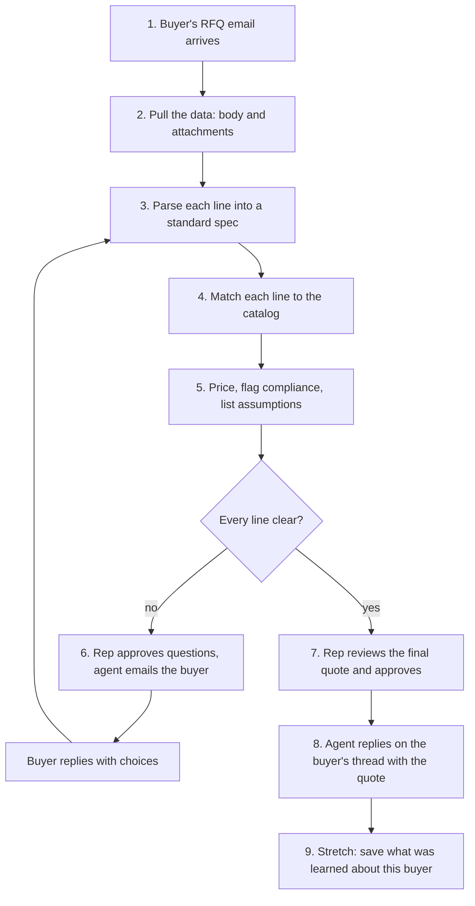

# RFQ to Quote: Demo Workflow

**Status:** Draft for Ken's review.

**Read with:** [the product brief](PRD.md) (what and why), [the frontend contract](../engineering/FRONTEND_CONTRACT.md) (Hirsh's routes and data shape), [the research report](../research/20261010.01_rfq_sharper_angle/report_rfq_sharper_angle.md) (why the quote shows its work).

## Needs your call

Hirsh asked these on the bulletin board, and they shape steps 6 to 8. Each has a recommendation.

- **W1. Does the rep approve clarifying questions before they go out?** Recommendation: yes. The brief says the agent drafts and a person sends. One click sends all questions in one email.
- **W2. How does the buyer answer?** Recommendation: by replying to the email, with numbered choices to pick from. It keeps the whole demo in email, the way RFQs really arrive. A secure answer link is a stretch.
- **W3. Does a buyer's answer rerun matching and pricing on its own?** Recommendation: yes, for the answered lines only. The rep still approves the final quote.
- **W4. Which catalog does the demo use?** Tisch's catalog is 200 aviation bolts (AN3 to AN8). The brief, the research, and RudCo's own site are about metals and abrasives: sheet, plate, tube, shot, grit, aluminum ingot. Recommendation: build the demo RFQ from metals lines and keep the bolts as a second RFQ if time allows. Ken to confirm with Tisch.

---

## The flow

The loop from the buyer's reply back to step 3 reruns only the lines the buyer answered.

## The steps

### 1. The RFQ email arrives

- **What happens:** a buyer's email lands in RudCo's quote inbox. It has a short body and one or two attachments: a PDF and a spreadsheet.
- **For the demo:** we write one realistic RFQ email, built from the [test set](../research/20261010.01_rfq_sharper_angle/research_domain_rules.md#test-set). It mixes clean lines, the gauge trap, a contradiction, and a hidden requirement. It is labeled as sample data.
- **The rep sees:** a new RFQ in the workspace list, with the buyer's name, the subject, and a count of lines.

### 2. Pull the data from the email

- **What happens:** the agent saves the email body and every attachment as received. It extracts the text from each one. PDFs go through `tools/pdf_text`; spreadsheets are read row by row. It keeps where each line came from: the attachment, the page, and the row.
- **Method:** fixed rules. No AI is needed to read a file.
- **Fails loudly when:** a PDF is a scan with no text, a file is password protected, or an attachment type is unsupported. The rep sees which file failed and why.

### 3. Parse each line into a standard spec

- **What happens:** each line becomes material, grade, form, thickness, width, length, quantity, and standard.
- **Method:**
  - The LLM reads the messy text into fields.
  - Fixed rules do the rest: gauge to thickness (by material and form), units, and dimension order.
- **Shows its work:** every field links back to the exact words it came from, and to the gauge table or rule it used. Example: "16 ga" on a stainless line reads as 0.0625 in, from the stainless gauge table.
- **Unclear fields stay empty.** Nothing is guessed. The line is marked for a question.

### 4. Match each line to the catalog

- **What happens:** the matcher finds the catalog item RudCo stocks for each line.
- **Method:** matching and scoring, using a decision engine like Jev. Tisch owns the matcher.
- **Three outcomes:**
  - **Match:** one catalog item fits, shown with its SKU.
  - **Candidates:** two or more fit. The line becomes a question to the buyer, with the candidates as choices.
  - **No match:** nothing in the catalog fits. The line is never forced onto the closest item.

### 5. Price, flag compliance, list assumptions

- **Price:** each matched line gets a price beside a named, dated benchmark. The quote says the price tracks published metal cost plus RudCo's margin. It never claims RudCo is cheapest. No benchmark means no price: the line is held.
- **Compliance flags:** mill test reports, certifications, country of origin, DFARS, Buy America. Each flag highlights the words that triggered it, such as "DFARS", "SA-240", or "domestic". A flag that comes from context, like a defense ship-to, says so.
- **Assumptions:** each line lists what it assumed. Examples: finish not stated, dual cert accepted, spec edition.

### 6. Send clarifying questions to the buyer

- **What happens:** every held line gets one specific question with choices. Example: "Line 3 says 16 gauge and 0.060 in. These differ. Do you need (a) 16 gauge, 0.0625 in, or (b) exactly 0.060 in?"
- **The rep:** reviews the questions, edits any, and sends them all in one email with one click (W1).
- **The buyer:** replies with the choice numbers (W2). The agent reads the reply and reruns steps 3 to 5 for those lines only (W3).
- **Clear lines keep moving.** A question on line 3 does not hold up lines 1 and 2.

### 7. Present the final quote for approval

- **The rep sees:** the original RFQ beside the quote, line by line.
  - Click any field to see its source words.
  - Each line shows its benchmark, its flags, and its assumptions.
  - Status for each line: ready, waiting on the buyer, or no match.
- **The rep can:** edit any field, which marks it as a rep edit, then approve. Approval covers the whole quote. Any edit after approval clears it.

### 8. Send the quote back to the buyer

- **What happens:** the agent replies on the buyer's original email thread. The reply holds the quote, the compliance notes, and any open questions on held lines.
- **The rep:** clicks send. The agent drafts; the rep sends.
- **Format:** a short email body, plus the quote as a PDF and a spreadsheet.

### 9. Stretch: learn the buyer

- **What happens:** when the rep confirms or corrects a reading, the agent saves it for that buyer. Examples: this buyer's "16 ga" means 0.060 in; this buyer always needs a 3.1 cert.
- **On the next RFQ from that buyer:** the agent applies what it learned and says so on the line. Example: "Read as 0.060 in, as you confirmed on RFQ-0001." The rep can undo it.
- **Why it still shows trust:** the learned reading is visible and has a source, like every other field. Two vendors (Proton, Canals) claim to learn customer shorthand, but neither shows where a reading came from.
- **For the demo:** a second, short RFQ from the same buyer, where the gauge line comes through already resolved.

---

## The video demo, in order

1. Show the RFQ email with its attachments.
2. Open it in the workspace. The lines appear, each with a status.
3. Click the stainless line. Show "16 ga" reading as 0.0625 in, with the table named. Point out that RudCo's own challenge treats it as 0.060 in.
4. Show a hidden-requirement flag, with its trigger word highlighted.
5. Show a price beside its named, dated benchmark.
6. Approve and send the questions. Show the buyer's reply coming back, and the line turning ready.
7. Approve the final quote. Show the reply on the buyer's thread.
8. Stretch: send a second RFQ from the same buyer. Show the gauge line resolved from what the agent learned.

## Who owns each step

| Step | Owner |
|---|---|
| 1. Sample RFQ email | Ken writes the email; Yuval checks it parses |
| 2. Pull the data | Yuval |
| 3. Parse | Yuval |
| 4. Match | Tisch |
| 5. Price and flags | Tisch (price), Yuval (flags) |
| 6. Questions and replies | Hirsh |
| 7. Review and approve | Hirsh |
| 8. Send the reply | Hirsh |
| 9. Learn the buyer (stretch) | To be decided |

This table reflects the bulletin board as of 12:39. Owners, correct it if it is wrong.
