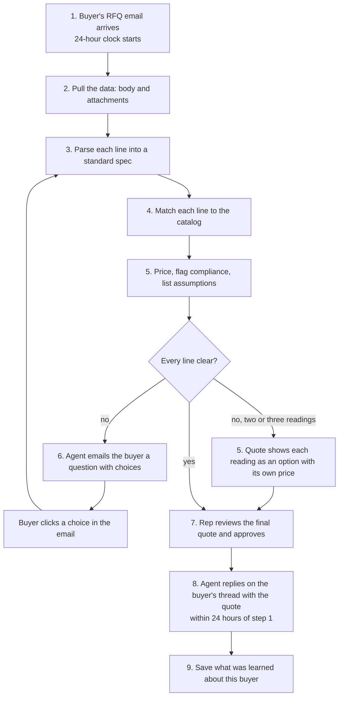

# RFQ to Quote: Demo Workflow

**Status:** Approved by Ken, 2026-10-10. Every agent building a step reads its section here.

**Read with:** [the product brief](PRD.md) (what and why), [the frontend contract](../engineering/FRONTEND_CONTRACT.md) (Hirsh's routes and data shape), [the research report](../research/20261010.01_rfq_sharper_angle/report_rfq_sharper_angle.md) (why the quote shows its work).

## Needs your call

Hirsh asked these on the bulletin board, and they shape steps 6 to 8. Each has a recommendation. Decided items move to [Decisions](#decisions) at the bottom.

Nothing open.

---

## The flow

The loop from the buyer's reply back to step 3 reruns only the lines the buyer answered. A line with no match, or with no benchmark price, is held and rides along in the quote.

**The 24-hour requirement.** The quote reaches the buyer within 24 hours of step 1, even when some lines are unclear. An unclear line never holds the quote back. It goes out as priced options (step 5), with its question open (step 6).

## The steps

### 1. The RFQ email arrives

- **What happens:** a buyer's email lands in RudCo's quote inbox. It has a short body and one or two attachments: a PDF and a spreadsheet.
- **The clock starts here.** RudCo's quote form promises a reply within 24 hours. The quote must reach the buyer within 24 hours of this email.
- **For the demo:** we write one realistic RFQ email, built from the [test set](../research/20261010.01_rfq_sharper_angle/research_domain_rules.md#test-set). It mixes clean lines, the gauge trap, a contradiction, and a hidden requirement. It uses RudCo's own materials (steel shot S-330, P1020 aluminum ingot, aluminum 356, steel plate) next to the stainless gauge line, so it looks like their business. The Devpost stainless example is outside RudCo's listed range.
- **The rep sees:** a new RFQ in the workspace list, with the buyer's name, the subject, and a count of lines.

### 2. Pull the data from the email

- **What happens:** the agent saves the email body and every attachment as received. It extracts the text from each one. PDFs go through `tools/pdf_text`; spreadsheets are read row by row. It keeps where each line came from: the attachment, the page, and the row.
- **Method:** fixed rules. No AI is needed to read a file.
- **Fails loudly when:** a PDF is a scan with no text, a file is password protected, or an attachment type is unsupported. The rep sees which file failed and why.

### 3. Parse each line into a standard spec

- **What happens:** each line becomes material, grade, form, thickness, width, length, quantity, and standard.
- **Method:**
  - The LLM reads the messy text into fields.
  - Fixed rules do the rest: gauge to thickness (by material and form), units, and dimension order.
- **Shows its work:** every field links back to the exact words it came from, and to the gauge table or rule it used. Example: "16 ga" on a stainless line reads as 0.0625 in, from the stainless gauge table.
- **Unclear fields stay empty.** Nothing is guessed. The line is marked for a question.
- **Two readings are both kept.** When a field has two readings, such as "16 ga" and "0.060 in", processing returns both with their source words. Step 5 prices each one.

### 4. Match each line to the catalog

- **What happens:** the matcher finds the catalog item RudCo stocks for each line.
- **Method:** matching and scoring, using a decision engine like Jev. Tisch owns the matcher.
- **Three outcomes:**
  - **Match:** one catalog item fits, shown with its SKU.
  - **Candidates:** two or more fit. The line becomes a question to the buyer, with the candidates as choices. The quote also shows each candidate as an option with its own price (step 5).
  - **No match:** nothing in the catalog fits. The line is never forced onto the closest item.

### 5. Price, flag compliance, list assumptions

- **Price:** each matched line gets a price beside a named, dated benchmark. The quote says the price tracks published metal cost plus RudCo's margin. It never claims RudCo is cheapest. No benchmark means no price: the line is held.
- **Alternates:** when a line has two or three candidates, or two readings, the quote does not hold the line. It prices each one as an option, for example "Option A: 16 ga, 0.0625 in" and "Option B: exactly 0.060 in". Each option carries its own benchmark, lead time, flags, and assumptions. The buyer picks one when they accept. The quote shows every reading and never picks one quietly. An option with no benchmark price shows no price and says why. A line with no match is still held.
- **Lead time:** each line shows when it can ship. Stocked lines use RudCo's 24 to 48 hour promise. Anything else says "to confirm" rather than guessing.
- **Compliance flags:** mill test reports, certificates of analysis (COA), certifications, country of origin, DFARS, Buy America, REACH, RoHS. Each flag highlights the words that triggered it, such as "DFARS", "SA-240", or "domestic". A flag that comes from context, like a defense ship-to, says so.
- **Assumptions:** each line lists what it assumed. Examples: finish not stated, dual cert accepted, spec edition.

### 6. Send clarifying questions to the buyer

- **What happens:** every unclear line gets one specific question with a few choices. The question goes out even when the quote already shows the readings as priced options. Example: "Line 3 says 16 gauge and 0.060 in. These differ. Do you need 16 gauge (0.0625 in) or exactly 0.060 in?"
- **Who sends it:** the agent scores how sure it is that the choices cover what the buyer meant.
  - **Confident:** the email goes out on its own.
  - **Not confident:** the rep reviews and edits the question first, then sends it.
- **The buyer:** clicks a button in the email for the choice they want. The click updates the RFQ on its own. Replying with the choice number also works.
- **Then:** the agent reruns steps 3 to 5 for the answered lines only, with the guards listed under W3 in [Decisions](#decisions).
- **Clear lines keep moving.** A question on line 3 does not hold up lines 1 and 2. It does not hold up line 3 either: the quote shows line 3's readings as priced options, and the buyer picks one when they accept.

### 7. Present the final quote for approval

- **The rep sees:** the original RFQ beside the quote, line by line.
  - Click any field to see its source words.
  - Each line shows its benchmark, its flags, and its assumptions.
  - Status for each line: ready, needs the buyer, or no match. A needs-the-buyer line with two or three readings shows each option with its price.
- **The rep can:** edit any field, which marks it as a rep edit, then approve. Approval covers the whole quote. Any edit after approval clears it.

### 8. Send the quote back to the buyer

- **What happens:** the agent replies on the buyer's original email thread. The reply holds the quote, the compliance notes, and any open questions. It goes out within 24 hours of step 1, so the rep's review fits inside that window.
- **The rep:** clicks send. The agent drafts; the rep sends.
- **Format:** a short email body, plus the quote as a PDF and a spreadsheet. Each line shows its price, benchmark, lead time, and the paperwork that ships with it. A line with alternates lists each option with its own price, and the buyer picks one when they accept.

### 9. Learn the buyer

- **What happens:** when the rep confirms or corrects a reading, the agent saves it for that buyer. Examples: this buyer's "16 ga" means 0.060 in; this buyer always needs a 3.1 cert.
- **On the next RFQ from that buyer:** the agent applies what it learned and says so on the line. Example: "Read as 0.060 in, as you confirmed on RFQ-0001." The rep can undo it.
- **Why it still shows trust:** the learned reading is visible and has a source, like every other field. Two vendors (Proton, Canals) claim to learn customer shorthand, but neither shows where a reading came from.
- **For the demo:** a second, short RFQ from the same buyer, where the gauge line comes through already resolved.

---

## The video demo, in order

1. Show the RFQ email with its attachments. Say the line: RudCo promises a quote within 24 hours; watch the agent draft it in minutes.
2. Open it in the workspace. The lines appear, each with a status.
3. Click the stainless line. Show "16 ga" reading as 0.0625 in, with the table named. Point out that RudCo's own challenge treats it as 0.060 in.
4. Show a hidden-requirement flag, with its trigger word highlighted.
5. Show a price beside its named, dated benchmark.
6. Show the question email going out, the buyer clicking a choice, and the line turning ready.
7. Approve the final quote. Show the reply on the buyer's thread. Close on the framing: the agent prepares the conversation, and the rep owns it.
8. Send a second RFQ from the same buyer. Show the gauge line resolved from what the agent learned.

## Who owns each step

| Step | Owner |
|---|---|
| 1. Sample RFQ email | Tisch writes the email (Ken handed it over); Yuval checks it parses |
| 2. Pull the data | Yuval |
| 3. Parse | Yuval (returns every reading and candidate for an unclear line) |
| 4. Match | Tisch |
| 5. Price and flags | Tisch (price, including the price of each option), Yuval (flags) |
| 6. Questions and replies | Hirsh |
| 7. Review and approve | Hirsh (shows alternates on the review screen) |
| 8. Send the reply | Hirsh (shows alternates in the quote PDF and email) |
| 9. Learn the buyer | Yuval (parsing side), Tisch (per-buyer memory tables), Hirsh (proposed: where the rep confirms a reading) |

This table reflects the bulletin board as of 12:39. Owners, correct it if it is wrong.

## Decisions

- **W1. Clarifying questions send on their own when the agent is confident** (Ken, 2026-10-10). If the agent is confident it can name the choices the buyer meant, the email goes out with no review. If not, the rep reviews it first. The final quote still needs the rep's approval. Each sent question is recorded and shown on its line ("Question sent 2:41 PM"), and the line reads "Waiting on buyer". Sending a question never blocks the rest of the quote.
- **W2. The buyer answers by clicking a choice in the email** (Ken, 2026-10-10). Each choice is a button. A click updates the RFQ on its own. Replying with the choice number also works. No login is needed for the demo: the buttons work without the buyer signing in.
- **Build order for Hirsh: the final email and PDF first** (Ken, 2026-10-10). Step 8 is the core demo. Buyer-answer buttons (step 6) and re-quote redlines come after it.
- **Email for the demo: letter_opener first, then a real email account** (Ken, 2026-10-10). letter_opener shows each sent email in the browser during development, so the question and quote emails can be shown on screen. The goal after that is a real email account, so a real buyer email comes in and a real reply goes out.
- **The confidence gate for auto-sending questions** (Ken, 2026-10-10; Hirsh owns it). A question sends on its own only when every choice is tied to catalog or spec evidence, no conflict is left unresolved outside the question, and the buyer can always write their own answer. Otherwise the rep reviews it first.
- **W3. A buyer's answer reruns only the answered lines, on its own** (Ken, 2026-10-10). The rep still approves the final quote. Edge cases and their guards:
  - **An answer that covers more than one line.** "All of it needs DFARS" or "everything is 304L" changes lines the buyer did not answer. If the answer applies to the whole RFQ, every line reruns.
  - **The rep already edited the line.** A rerun never overwrites a field the rep edited. It flags the conflict for the rep instead.
  - **A line turns Ready without the rep noticing.** A rerun clears approval and highlights what changed. The rep approves again.
  - **Lines from two processing runs on one quote.** Untouched lines keep their older benchmark dates. Every price already shows its benchmark date, and each line records which run it came from (the per-run revision ID).
- **Learn the buyer is in scope, not a stretch goal** (Ken, 2026-10-10). Step 9 gets built. A reading the rep confirms is saved for that buyer and applied to their next RFQ, and the line says where the reading came from. The demo shows a second RFQ from the same buyer with the gauge line already resolved.
- **W4. The demo uses metals first, bolts second** (Tisch, 2026-10-10). The demo RFQ draws on RudCo's own catalog rows (steel shot, grit, abrasives, P1020, 356 and A356 ingot) and the sample metals catalog (sheet, plate, tube, bar, pipe). The aviation bolts stay as a third catalog.
- **W5. RudCo's 24-hour quote promise is a core requirement** (Ken, 2026-10-10). RudCo's own quote form promises a reply "within 24 hours" ([site code](https://www.rud-co.com/assets/index-B04wKX3n.js)). Every RFQ gets a quote back to the buyer within 24 hours, even when some lines are unclear. It is a requirement on the build, and it is also the speed line in the video.
- **W6. The quote shows alternates on unclear lines** (Ken, 2026-10-10). When the matcher finds two or three candidates for a line, or a line has two readings such as "16 ga" and "0.060 in", the quote does not hold the line. It shows each reading as an option with its own price. The buyer picks one when they accept. The clarifying question still goes out. Nothing is guessed: every reading is shown, and none is picked quietly. A line with no match, or with no benchmark price, is still held. Owners: Yuval's processing already returns the candidates; Tisch prices each candidate (this needs the pricer); Hirsh shows alternates on the review screen and in the quote PDF.
