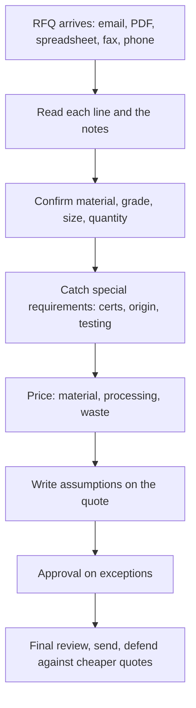

# Report: What Matters in RFQ to Quote

## 1. Governing question

**What are the real problems and value props in going from an industrial RFQ to a sent quote, and which matter most to quoting reps and buyers?** Within that: what part of the job hurts most and is not already solved by existing tools, so the RudCo demo can win on uniqueness and trust?

It supports two decisions:

1. What the product puts first.
2. Which angle Ken builds into the demo today.

## 2. Why now

Hacking ends at 4:30 PM ET today, Saturday, October 10, 2026. A video demo is due with the Devpost submission. Uniqueness is one of four judging criteria, each scored out of 5. Trust and explainability is another, and it is the event's theme. The angle has to be picked while there is still time to build it.

## 3. Methods

- Web research on industry forums, trade press, vendor case studies, and public government RFQs ([open-web track](#appendix-voice_open_web)).
- A Reddit voice-of-user loop: 25 search pages and 15 threads, saved by hand, read by an agent, every quote checked by script against the saved text ([Reddit track](#appendix-voice_reddit)).
- Job postings, software review sites, podcast notes, Hacker News, and employee reviews ([other-sources track](#appendix-voice_other_sources)).
- A domain-rules review of gauge tables, ASTM specs, and certification rules, with a 25-line test set ([domain-rules track](#appendix-domain_rules)). Thickness gaps come from the track's script, `domain_rules_gauge_calc.py`.
- A comparison of about 15 existing quoting tools from their public pages, plus a survey of public metal price sources ([tools and prices track](#appendix-tools_and_prices)).
- No separate data-munging pass. The only structured data is the Reddit corpus, and the Reddit agent already counted it by script into `voc_records.jsonl`.

## 4. Executive summary

The job an industrial supplier's quoting rep does all day is simple to say: send the buyer an accurate, competitive quote before a competitor does. The hard part is reading the request. A line like "304 SS sheet 16ga 4x8" packs material, grade, thickness, size and quantity into a code. Each piece has a trap. A gauge number means a different thickness for every metal: 16 gauge is 0.0598 in for mild steel and 0.0625 in for stainless. Two specs written with a slash, like "A513/A500," are two different products. And a requirement the buyer never wrote down, like a domestic-melt rule on a defense order, can turn an ordinary-looking quote into metal nobody can use.

The evidence is clear about where the money goes. The costliest mistakes are the ones that travel: the wrong grade, a missed note, or a certification gap found after the metal has been cut or shipped. Reddit posters describe a $250k job that cost about $450k after the wrong stainless was bought, and a $15-20k profit that shrank to $2-3k because a material price in the system was stale. Speed matters too, but every number claiming that the first quote wins comes from companies that sell quoting software.

The market has already noticed the basic idea. At least four funded startups (Avent, Hexa, Mercura, Proton) say they turn messy RFQs into draft quotes for a rep to approve. One already claims to learn each customer's shorthand. What none of them claims on its public pages is the part the judges care about most: showing where each answer came from, flagging requirements the buyer did not spell out, and asking the buyer a precise question instead of guessing.

That is the opening. The winning demo is a quote that shows its work. Every field is linked to the RFQ words it came from and the table it used. Each line lists its assumptions and its compliance flags, with the trigger text highlighted. When it cannot tell, it asks the buyer one specific question. RudCo's own example makes the case on stage: the two lines its challenge calls "the same item" are 4.2% apart in thickness, and a tool that catches that, and says why, is the trust story in one line.

## 5. Researcher's position

Build **the quote that shows its work, with hidden-requirement flags as its sharpest feature**. Treat these as one angle, not two. Every line carries three things next to it:

- the RFQ words each field came from, and the gauge table or rule used
- an assumptions and exceptions list: finish not stated, dual cert accepted, spec edition
- compliance flags, each with the words that triggered it highlighted ("DFARS", "SA-240", "domestic", a defense ship-to)

Unclear lines become one-click buyer questions. Lead the demo with RudCo's own example: show that "16ga" stainless and "0.060 in" are not the same thickness, and that the tool asks instead of guessing. Put "learns the buyer's shorthand" last. A vendor already claims it, and it is the hardest to show honestly in one afternoon.

For pricing, show the benchmark's name and date on every line. Say the price tracks published metal cost plus RudCo's margin, never that RudCo is cheapest. The stale-price story is the reason: a price with no visible source and date is how a quote loses money silently.

Confidence: **moderate (about 70%)** that this beats the other angles on uniqueness and trust. That the gap in existing tools is real rests on vendor pages, not product tests. The pain evidence comes mostly from job shops, fabricators and buyers, not RudCo-style distributor reps, who barely appear in public. Confidence is **high** that leading with reading accuracy and the gauge example is right, because judges test against real cases and these cases are checkable.

Claude

## 6. Findings

**A caveat that applies to everything below.** Quoting reps at metals service centers and distributors, the people closest to RudCo's user, almost never post in public. Their voice reaches this report mostly through employers' job postings and vendors' case studies. The first-person voices are job-shop owners, fabricators, machinists, and buyers. Every statistic about speed winning orders comes from a company that sells quoting software. Read the value-prop ranking with that in mind.

### 6.1 The job, step by step

**The rep reads the request, checks every detail, catches special requirements, prices it, writes down the assumptions, and reviews the quote before it goes out.** The clearest description is a Toledo steel supplier's estimator posting, read directly. Its thirteen duties run from "Review customer requests, emails, prints, and specifications" through "Identify special requirements such as testing, inspection, tolerances, or origin restrictions" to "Document assumptions, lead times, and any changes clearly on the quote so the customer is never surprised" and "Run a final review of every quote" ([Precision Steel Services posting](https://jobs.workable.com/jobs/0862cc67-073f-4e64-8eb0-0057c054e3bf.md)). A Detroit aluminum supplier tells its rep to "Always ask questions, never guess when something is unclear" and to catch "conflicting cert requirements" ([Nox Metals posting](https://startup.jobs/sales-development-representative-sdr-nox-metals-8027208)).

Reddit posters describe the same steps in pieces, plus two that postings leave out: waiting on a boss's approval, and defending against a cheaper quote that "hasn't accounted for X, Y or Z" ([r/metalworking](https://www.reddit.com/r/metalworking/comments/1vtls2e/whats_the_dumbest_little_thing_youve_seen_get/p4z7xpx/)).

::: xref
[Job postings in full](#appendix-voice_other_sources) [Steps from Reddit](#appendix-voice_reddit) [Steps from vendor case studies](#appendix-voice_open_web)
:::

### 6.2 Where the time goes

**Time goes to gathering and checking data, and to re-quoting when a buyer changes a gauge or grade.** A Distribution Strategy Group executive writes that on teams he built, people spent 75% of their time on data preparation, and in another passage that they spent 80% of their time hunting through systems, validating data, and assembling quotes by hand. Those are one practitioner's observations, not research ([Distribution Strategy Group](https://distributionstrategy.com/2025/07/beyond-the-spreadsheet-transforming-order-quote-processes/)). Utah Steel says a large job took about two days with three people on quotes, and that when customers asked for quote options in different materials or gauges, it "would require an entire trigger of changes in the quote" (vendor case study, [SecturaFAB](https://get.secturafab.com/customers/utah-steel)). On Reddit, one supplier-side poster says repeat RFQs eat "sometimes 10+ hours a week" ([r/procurement](https://www.reddit.com/r/procurement/comments/1jwtpla/who_else_is_stuck_doing_repetitive_rfqs_manually/)). The vendor that built Ryerson's quote tool says Ryerson gets a quote request by email every 4.5 minutes, and that quotes "often required multiple clarifying communications" ([Concurrency](https://partner.concurrency.com/), vendor writing).

**Quoting depends on a few senior people.** Brunswick Steel says quoting was limited to a select few ([SecturaFAB](https://get.secturafab.com/customers/brunswick-steel), vendor). At a pipe distributor, newer reps "had to lean on senior folks just to figure out substitutes or where to look" ([Canals case study](https://www.canals.ai/case-studies/puget-sound-pipe-and-supply-slashes-quote-times), vendor).

::: xref
[Time evidence](#appendix-voice_open_web) [Ryerson and Puget Sound](#appendix-voice_other_sources)
:::

### 6.3 The value props, ranked

**Accuracy comes first, then speed, then a complete, comparable quote, then rep time saved.** The ranking weighs how much each costs when it fails and who is saying it.

| Rank | Value prop | Strongest evidence | Who says it |
|---|---|---|---|
| 1 | **Avoid costly errors** | Wrong stainless bought: "a $250k job that ended up costing close to $450k" ([r/metalworking](https://www.reddit.com/r/metalworking/comments/1vtls2e/whats_the_dumbest_little_thing_youve_seen_get/p4w0ody/)). 1,800 pieces of tubing cut and machined, then left unusable, after 303 arrived instead of 304 ([Evident](https://ims.evidentscientific.com/en/insights/the-case-of-the-cracked-weld-a-metal-manufacturers-story), sells analyzers) | Suppliers, self-reported |
| 2 | **Speed to the first full quote** | A buyer post scored 222 on Reddit compares shops that never reply with tools that quote "within 24hours" ([r/CNC](https://www.reddit.com/r/CNC/comments/1s81l5g/why_are_us_machine_shops_so_difficult_to_work_with/)). Win-rate claims all come from vendors | Buyers; vendors |
| 3 | **A complete, comparable quote** | Buyers' own RFQs demand unit price, delivery date, shipping included, and SAM registration with FAR and DFARS reps and certs ([USACE RFQ](https://www.bidnetdirect.com/public/supplier/solicitations/statewide/2403776002/abstract)). Buyers complain that suppliers "technically answer the RFQ but don’t answer it on the same basis" ([r/procurement](https://www.reddit.com/r/procurement/comments/1w1lwdg/what_fields_make_supplier_quotes_comparable/p6t572u/)) | Buyers |
| 4 | **Rep time on repeat work** | "10+ hours a week" (above). A pipe distributor's inside sales manager says in a vendor case study he has typed some items "tens of thousands of times—and still made mistakes" ([Canals](https://www.canals.ai/case-studies/puget-sound-pipe-and-supply-slashes-quote-times)) | Suppliers |

**Speed numbers are vendor numbers.** A 2020 Paperless Parts survey says 67% of buyers expect a quote in under 24 hours ([Paperless Parts](https://www.paperlessparts.com/blog/the-7-fatal-mistakes-of-quoting-3-responding-too-slowly/)). A consultant repeats that 50% of buyers pick the first responder, citing unnamed technology providers. A CloudForge customer says win rate rose over 50% ([Modern Metals](https://modernmetals.com/forging-the-future.html)). Each source sells quoting software or was chosen by one. No poster on Reddit ties faster quoting to a measured win rate.

::: xref
[Costly errors on Reddit](#appendix-voice_reddit) [Value props from vendors](#appendix-voice_open_web) [Value props from employers](#appendix-voice_other_sources)
:::

### 6.4 The costliest mistakes

**The mistakes that cost the most are the ones found after the metal is cut or shipped: wrong origin, wrong grade or spec family, and missed notes.** The domain-rules track ranks errors by whether they can be fixed after shipping:

1. Wrong or missing origin (DFARS, Buy America). Metal melted abroad cannot be repaired.
2. Wrong grade or spec family: 304 vs 316, A36 vs A572-50, A500 vs A513, A53 vs A500.
3. A missing certification. Fixable only if the heat number was tracked.
4. Wrong gauge table. It is silent, because the quote still looks normal.
5. Wrong unit or position, such as feet vs inches or a trailing "x4".
6. Sheet vs plate at the 3/16 in boundary.

That ranking is judgment from consequences. No public source prices a misread RFQ line. Reddit adds the categories rules miss: notes on the print. "Early in my career I missed a note calling out weld size" ([r/metalworking](https://www.reddit.com/r/metalworking/comments/1vtls2e/whats_the_dumbest_little_thing_youve_seen_get/p4u79mi/)). "Missed the part where it said the welds are to be purged" ([r/metalworking](https://www.reddit.com/r/metalworking/comments/1vtls2e/whats_the_dumbest_little_thing_youve_seen_get/p4u4jeg/)). It also adds stale prices: material pricing "wasn't getting updated like I thought it was" ([r/metalworking](https://www.reddit.com/r/metalworking/comments/1vtls2e/whats_the_dumbest_little_thing_youve_seen_get/p4ulybm/)). Most of the Reddit error stories come from one thread, with 13 commenters.

::: xref
[Error ranking](#appendix-domain_rules) [Error stories](#appendix-voice_reddit) [Wrong-grade cases](#appendix-voice_open_web)
:::

### 6.5 Messy lines and the gauge trap

**RudCo's own example of "the same item" is two different items.** In the [challenge](https://get-hired-hack-nyc.devpost.com/), "304 SS sheet 16ga 4x8" and "Stainless 304, 0.060 in, 48 x 96" stand for one item. They are not. 16 gauge stainless is 0.0625 in. 0.060 in matches 16 gauge mild steel, 0.0598 in. The gap is 4.2% of thickness ([Metal Supermarkets gauge chart](https://www.metalsupermarkets.com/sheet-metal-gauge-chart/); gap from the domain-rules script).

| Gauge | Mild steel | Galvanized | Stainless | Aluminum |
|---|---|---|---|---|
| 14 | 0.0747 | 0.0785 | 0.07812 | 0.06408 |
| 16 | 0.0598 | 0.0635 | 0.0625 | 0.05082 |
| 18 | 0.0478 | 0.0516 | 0.050 | 0.04030 |

Reading the wrong table puts stainless about 4.5% thick and aluminum up to 24.2% thin (at 10 gauge). Tube wall has its own table again: 16 gauge tube wall is 0.065 in ([Wikipedia, Sheet metal](https://en.wikipedia.org/wiki/Sheet_metal)).

**Real public RFQs are messy in ways a parser can test.** An Air Force RFQ writes "STAINLESS Steel 2B T-304 - 16 Gage x 4 x 8 or similar" with no units, under lines that use feet ([BidNet, FA302024Q0014](https://www.bidnetdirect.com/public/supplier/solicitations/statewide/2476672502/abstract)). A 2021 State of Iowa RFQ gives a short name of "Stainless Tubing 1 x 1 x .05" over a description saying ".065 wall" ([Iowa RFQ, 2021](https://bidopportunities.iowa.gov/Home/GetBidOpportunityDocument/e7ca77d0-dcf9-41e7-ad5c-dc15cca2a45e)). A 2018 Iowa RFQ writes "Square Tube A513-A500 Grade B," which names two different products ([Iowa RFQ, 2018](https://bidopportunities.iowa.gov/Home/DownloadBidOpportunityDocument/1896a227-c6a4-4be5-8283-11490aefe20a)). The tracks together give the builders 25 test lines with readings and questions, plus 19 verbatim lines from Reddit.

::: xref
[Gauge tables and the 25-line test set](#appendix-domain_rules) [Government RFQ lines](#appendix-voice_open_web) [Reddit lines](#appendix-voice_reddit)
:::

### 6.6 Hidden requirements

**Employers expect reps to catch requirements the buyer may not spell out, and buyers say the paperwork is what they pay for.** "Those certs are what you're paying for," says a machinist with a top-voted comment, score 107 ([r/Machinists](https://www.reddit.com/r/Machinists/comments/1e5ga3t/what_extra_testing_do_military_grade_fasteners_go/ldllyym/)). A Navy RFQ for HY-80 plate makes full traceability, mill test reports, and DFARS 252.225-7009 compliance conditions of the quote itself ([HigherGov, N4215826QE068](https://www.highergov.com/contract-opportunity/mil-s-16216-hy-80-steel-plate-n4215826qe068-o-78f78/)).

**Most triggers sit outside the line, so the tool has to read the whole RFQ and stay quiet when nothing triggers.** The grade decides whether a rule can apply. Stainless counts as a specialty metal under DFARS because of its chromium ([DFARS 252.225-7009](https://www.acquisition.gov/dfars/252.225-7009-restriction-acquisition-certain-articles-containing-specialty-metals.)). The contract, the ship-to, or a priority rating on the PO decides whether it does apply. The 2018 Iowa RFQ, 49 lines long, names no certification or origin rule at all. A tool that flags everything would fail the product brief's own test against needless questions.

**The safe flags are the ones written in the line.** These words imply paperwork directly: `SA-240` (ASME code material), `A500` (ships with a mill test report), `304/304L` (dual cert), `NACE`, `DFARS`, `Buy America`, "domestic", `3.1`, `PMI`.

**"DFARS" and "domestic" get blurred.** One buyer asks for "DFARS Compliant 60 series aluminum. Also has to be made in the USA" ([r/Machinists](https://www.reddit.com/r/Machinists/comments/15kudev/looking_for_a_supplier_for_dfars_compliant_60/)). A commenter there says aluminum is exempt from DFARS. That claim is unchecked. By the clause's chemistry definition, it depends on the alloy, so the tool should ask rather than rule.

::: xref
[What triggers each requirement](#appendix-domain_rules) [Cert stories](#appendix-voice_reddit) [Requirements in job postings](#appendix-voice_other_sources)
:::

### 6.7 What existing tools already do

**The basic loop is already sold, so "AI reads the RFQ and drafts a quote" will not win on uniqueness.** Avent, Hexa, Mercura, and Proton each say they turn messy RFQs into draft quotes with a rep approving ([Avent](https://www.ycombinator.com/launches/OC1-avent-ai-agents-for-industrial-commerce), [Hexa](https://www.ycombinator.com/launches/Qfd-hexa-autonomous-operations-for-industrial-distributors), [Mercura](https://www.ycombinator.com/launches/Mun-mercura-quotes-in-minutes-not-days), [Proton](https://www.proton.ai/order-and-quote-automation)). None of them is metals-specific at the line level. No public product reads gauge, grade, and ASTM spec for a US metals supplier.

| Angle | Claimed by a vendor? | Gap |
|---|---|---|
| Quote shows its work | No vendor links each field to the RFQ words. Nearest: confidence scores ([Cassidy](https://web.archive.org/web/20260418173906/https://www.cassidyai.com/solutions/ai-rfq-data-extraction-agent)) | Open |
| One-click buyer questions | One vendor lists a Message Center to centralize communication as a planned update ([DigiFabster](https://3dprintingindustry.com/news/digifabsters-new-ai-powered-quote-agent-for-smooth-rfqs-processing-234831/)) | Open |
| Learns buyer shorthand | Proton claims it learns "your customers' nicknames." Canals claims it learns each customer's needs | Taken |
| Catches hidden requirements | No vendor mentions MTRs, DFARS, Buy America, or implied certs | Most open |

These are claims read from marketing pages. No tool was tested, so "open" means not claimed publicly.

**Users distrust AI output they cannot check.** "As anything with AI it is highly risky and hit-and-miss, as all models hallucinate AF you still have to check manually so there is no point" ([r/procurement](https://www.reddit.com/r/procurement/comments/1qn5ad5/how_do_you_compare_supplier_quotes_when_everyone/o1rvvaq/)). A reviewer praises Paperless Parts for "identifying features of a part that we might overlook," and complains its estimated cycle time is "a little off at times" ([SaaSworthy, G2 reviews](https://www.saasworthy.com/product/paperless-parts/reviews)). Trust follows whether the user can see why.

::: xref
[Tool comparison table](#appendix-tools_and_prices) [User voice on tools](#appendix-voice_other_sources)
:::

### 6.8 Price explanations the data can honestly support

**Public data gives market cost, not competitors' prices, so the quote should say its price tracks published metal cost plus margin.** The best free sources are the BLS producer price indexes for steel mill products and aluminum mill shapes on FRED ([steel](https://fred.stlouisfed.org/series/WPU1017), [aluminum](https://fred.stlouisfed.org/series/WPU102501)), and the IMF monthly nickel and aluminum prices on FRED ([nickel](https://fred.stlouisfed.org/series/PNICKUSDM)). Nickel drives stainless alloy surcharges. North American Stainless posts a monthly fuel surcharge publicly ([NAS](https://www.northamericanstainless.com/news)). Fastmarkets, CRU, and Platts are what the industry actually references, and they are paid. The stale-price story in 6.4 is the reason to show each benchmark's name and date on every line.

::: xref
[Price sources table](#appendix-tools_and_prices)
:::

### 6.9 The four angles, scored

**Show its work and hidden requirements score highest. Buyer questions are a strong supporting feature. Shorthand learning scores lowest.**

| Angle | User pain | Gap in existing tools | Shows trust to judges | Verdict |
|---|---|---|---|---|
| Quote shows its work | Employers require documented assumptions and a final review. Buyers want an exceptions column next to every line | Open | Highest: judges can check any field | **Build** |
| Catches hidden requirements | Certs are what buyers pay for. Missed notes and wrong grade are the costliest errors | Most open | High, if each flag shows its trigger text | **Build, inside show-its-work** |
| One-click buyer questions | "Always ask questions, never guess." A buyer-side commenter says to ask for "the exact missing field" | Open | High: "asks instead of guessing" is the brief | **Build as the fallback** |
| Learns buyer shorthand | Real, with thin evidence | Taken (Proton, Canals) | Low in a one-day demo | **Skip** |

A fifth idea comes out of the Reddit track: an exceptions and assumptions list beside each line. It is folded into "shows its work" above rather than treated as its own angle.

::: xref
[Angle analysis, Reddit](#appendix-voice_reddit) [Angle analysis, other sources](#appendix-voice_other_sources) [Angle analysis, domain rules](#appendix-domain_rules)
:::

## 7. Citations

### The challenge

- [Get Hired Hack, Devpost](https://get-hired-hack-nyc.devpost.com/)

### Job steps and value props

- [Precision Steel Services estimator posting](https://jobs.workable.com/jobs/0862cc67-073f-4e64-8eb0-0057c054e3bf.md)
- [Nox Metals SDR posting](https://startup.jobs/sales-development-representative-sdr-nox-metals-8027208)
- [Distribution Strategy Group, Hopkins, July 2025](https://distributionstrategy.com/2025/07/beyond-the-spreadsheet-transforming-order-quote-processes/)
- [SecturaFAB, Utah Steel](https://get.secturafab.com/customers/utah-steel)
- [SecturaFAB, Brunswick Steel](https://get.secturafab.com/customers/brunswick-steel)
- [Concurrency, Ryerson](https://partner.concurrency.com/)
- [Canals, Puget Sound Pipe & Supply](https://www.canals.ai/case-studies/puget-sound-pipe-and-supply-slashes-quote-times)
- [Paperless Parts, responding too slowly](https://www.paperlessparts.com/blog/the-7-fatal-mistakes-of-quoting-3-responding-too-slowly/)
- [Modern Metals, CloudForge](https://modernmetals.com/forging-the-future.html)

### Reddit threads

- [r/procurement, repetitive RFQs](https://www.reddit.com/r/procurement/comments/1jwtpla/who_else_is_stuck_doing_repetitive_rfqs_manually/)
- [r/procurement, comparable quote fields](https://www.reddit.com/r/procurement/comments/1w1lwdg/what_fields_make_supplier_quotes_comparable/p6t572u/)
- [r/procurement, comparing supplier quotes](https://www.reddit.com/r/procurement/comments/1qn5ad5/how_do_you_compare_supplier_quotes_when_everyone/o1rvvaq/)
- [r/metalworking, things missed on a fab quote](https://www.reddit.com/r/metalworking/comments/1vtls2e/whats_the_dumbest_little_thing_youve_seen_get/p4w0ody/)
- [r/CNC, US machine shops](https://www.reddit.com/r/CNC/comments/1s81l5g/why_are_us_machine_shops_so_difficult_to_work_with/)
- [r/Machinists, military fasteners](https://www.reddit.com/r/Machinists/comments/1e5ga3t/what_extra_testing_do_military_grade_fasteners_go/ldllyym/)
- [r/Machinists, DFARS aluminum](https://www.reddit.com/r/Machinists/comments/15kudev/looking_for_a_supplier_for_dfars_compliant_60/)

### RFQs and domain rules

- [Metal Supermarkets gauge chart](https://www.metalsupermarkets.com/sheet-metal-gauge-chart/)
- [Wikipedia, Sheet metal](https://en.wikipedia.org/wiki/Sheet_metal)
- [USAF RFQ FA302024Q0014, BidNet](https://www.bidnetdirect.com/public/supplier/solicitations/statewide/2476672502/abstract)
- [USACE steel RFQ, BidNet](https://www.bidnetdirect.com/public/supplier/solicitations/statewide/2403776002/abstract)
- [State of Iowa RFQ 245, 2018](https://bidopportunities.iowa.gov/Home/DownloadBidOpportunityDocument/1896a227-c6a4-4be5-8283-11490aefe20a)
- [State of Iowa RFQ 245, 2021](https://bidopportunities.iowa.gov/Home/GetBidOpportunityDocument/e7ca77d0-dcf9-41e7-ad5c-dc15cca2a45e)
- [Navy HY-80 RFQ, HigherGov](https://www.highergov.com/contract-opportunity/mil-s-16216-hy-80-steel-plate-n4215826qe068-o-78f78/)
- [DFARS 252.225-7009](https://www.acquisition.gov/dfars/252.225-7009-restriction-acquisition-certain-articles-containing-specialty-metals.)
- [Evident, the case of the cracked weld](https://ims.evidentscientific.com/en/insights/the-case-of-the-cracked-weld-a-metal-manufacturers-story)

### Tools and prices

- [Avent, YC launch](https://www.ycombinator.com/launches/OC1-avent-ai-agents-for-industrial-commerce)
- [Hexa, YC launch](https://www.ycombinator.com/launches/Qfd-hexa-autonomous-operations-for-industrial-distributors)
- [Mercura, YC launch](https://www.ycombinator.com/launches/Mun-mercura-quotes-in-minutes-not-days)
- [Proton.ai, order and quote automation](https://www.proton.ai/order-and-quote-automation)
- [Cassidy RFQ agents](https://web.archive.org/web/20260418173906/https://www.cassidyai.com/solutions/ai-rfq-data-extraction-agent)
- [DigiFabster AI Quote Agent, 3D Printing Industry](https://3dprintingindustry.com/news/digifabsters-new-ai-powered-quote-agent-for-smooth-rfqs-processing-234831/)
- [SaaSworthy, Paperless Parts reviews](https://www.saasworthy.com/product/paperless-parts/reviews)
- [FRED, PPI steel mill products](https://fred.stlouisfed.org/series/WPU1017)
- [FRED, PPI aluminum mill shapes](https://fred.stlouisfed.org/series/WPU102501)
- [FRED, IMF nickel price](https://fred.stlouisfed.org/series/PNICKUSDM)
- [North American Stainless news](https://www.northamericanstainless.com/news)
